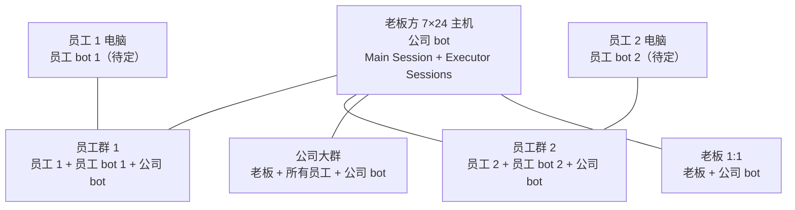
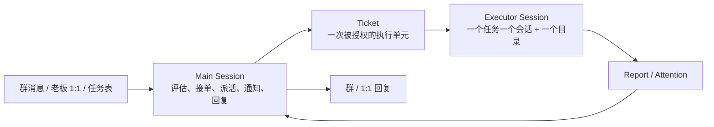

# 未来发展设计（现阶段）

> 类型：方向（master，设计树）

> 状态：设计草案 v0.2 · 2026-11-07
>
> **这份文档描述“要建成什么”，不是“现在已经有什么”。** 现状以 [ARCHITECTURE.md](./ARCHITECTURE.md)、[module-map.json](../module-map.json) 和 [modules/](./modules/) 为准；两者冲突时，先改设计，再改代码。
>
> **读法：这是一棵设计树。**
> - **主干**：你对项目的一个核心想法，尽量保留你的原话。
> - **分支**：我们讨论后落成的设计决定。
> - **叶子**：还没定的问题，集中在第 6 节，不替你编。
>
> 参考：DeepSeek Harness 的 [dsh-superagent 原型](https://github.com/deepseek-ai/dsh-superagent-prototype)（`000-philosophy` / `001-domain` / `003-execution` / `004-prompts`），以及 OpenAI《The Future of the Firm》里 “between us” 的组织位置。借的是模型，不是代码。

**一句话**：把公司 bot 做成老板与员工之间的 between-us 层——接住公司里的任务，自己排期、自己执行，只在人必须行动或能使用结果时说话。

**已定 / 未定**：

- 已定：两层结构、Task/Ticket/Assignment、确认协议、老板最高权限、公司大群能力不削、P0/P1/P2 排期、只有 Main 对人说话。
- 常驻：主干 0 收尾/清债/现状修正；零缺口才 ✅，新缺口自动重开。
- 待确认：公司大群隐私路由、责任回执的粒度。
- 待设计：员工 bot 的本地执行 / 离线行为、知识边界、WorkBuddy 执行器适配、身份映射。

## 设计树总览

```text
项目
├─ 主干 0：收尾、清债与现状修正（常驻）
│  ├─ 0.1 Bug / 回归
│  ├─ 0.2 技术债 / 重构
│  ├─ 0.3 文档 / 契约缺口
│  ├─ 0.4 运维 / 部署缺口
│  ├─ 0.5 安全 / 合规
│  ├─ 0.6 测试 / 覆盖缺口
│  └─ 0.7 设计反哺 / 现状修正
├─ 主干 1：两种部署、四种角色、两类群（+ 老板 1:1）
│  ├─ 分支 1.1 谁部署在哪
│  ├─ 分支 1.2 谁在哪个群、谁说话
│  ├─ 分支 1.3 老板 1:1 与公司大群
│  └─ 分支 1.4 这一支还没定
├─ 主干 2：公司 bot 是 super-agent，自己看任务、自己干
│  ├─ 分支 2.1 Main Session + Executor Session
│  ├─ 分支 2.2 Task / Ticket / Assignment / Report / Attention
│  ├─ 分支 2.3 任务从哪来、怎么排期
│  ├─ 分支 2.4 双工作区：群交互 vs 任务执行
│  ├─ 分支 2.5 状态
│  └─ 分支 2.6 这一支还没定
├─ 主干 3：between us，先自主完成，再通知人
│  ├─ 分支 3.1 三种需要人的情况
│  ├─ 分支 3.2 群回复确认协议
│  ├─ 分支 3.3 谁有资格确认、责任怎么交
│  ├─ 分支 3.4 通知谁才是对的
│  ├─ 分支 3.5 一条完整的链
│  └─ 分支 3.6 这一支还没定
├─ 主干 4：员工 bot（部分已定）
│  ├─ 分支 4.1 群与对话边界
│  ├─ 分支 4.2 身份与补丁
│  ├─ 分支 4.3 职责范围
│  ├─ 分支 4.4 本地执行 / 离线
│  └─ 分支 4.5 这一支还没定
├─ 横切规则 A：权限与可见性
├─ 横切规则 B：排期与抢占
└─ 横切规则 C：失败、恢复、审计
```

### 进度标记规则

每个分支标题带 `（设计 ✅ / 实现 ⬜）`，主干标题带汇总状态。

- `✅` 完成；`🟡` 进行中；`⬜` 未开始；`⏸` 被叶子卡住。
- **设计完成**：这个分支要做的决定已经拍板，写进文档。
- **实现完成**：代码、测试、部署/文档引用都落地。
- **主干完成**：该主干下所有分支的**设计和实现都 ✅**。只有设计全 ✅ 标 `设计 ✅ / 实现 ⬜`；有分支没定标 🟡；全没开始标 ⬜。
- 改一个分支时，同步改本节总表和主干标题；不要只改标题、不改汇总。
- **不要把“讨论过”当成“实现完成”。**

### 进度总表

| 主干 | 分支 | 设计 | 实现 | 说明 |
|---|---|---|---|---|
| 0 | 0.1 Bug / 回归 | ✅ | 🟡 | 流程已定；有 `GAP-032` 待清 |
| 0 | 0.2 技术债 / 重构 | ✅ | 🟡 | 常驻 |
| 0 | 0.3 文档 / 契约缺口 | ✅ | 🟡 | 常驻 |
| 0 | 0.4 运维 / 部署缺口 | ✅ | 🟡 | 常驻 |
| 0 | 0.5 安全 / 合规 | ✅ | 🟡 | 常驻 |
| 0 | 0.6 测试 / 覆盖缺口 | ✅ | 🟡 | 常驻 |
| 0 | 0.7 设计反哺 / 现状修正 | ✅ | 🟡 | 未来主干纠正旧行为/旧契约 |
| **0** | **主干 0 汇总（常驻）** | **✅** | **🟡** | 当前有开放缺口；零缺口才 ✅ |
| 1 | 1.1 谁部署在哪 | ✅ | 🟡 | 公司 bot/主机已有；员工 bot 待定 |
| 1 | 1.2 谁在哪个群、谁说话 | 🟡 | ⬜ | 隐私路由、员工 bot 主答待定 |
| 1 | 1.3 老板 1:1 与公司大群 | 🟡 | ⬜ | 1:1 通道待验证 |
| **1** | **主干 1 汇总** | **🟡** | **⬜** | 1/3 分支设计 ✅ |
| 2 | 2.1 Main + Executor | ✅ | ⬜ | 两层结构已定；WorkBuddy 适配未做 |
| 2 | 2.2 Task / Ticket / Assignment | ✅ | ⬜ | 模型已定；表/迁移未做 |
| 2 | 2.3 任务来源与排期 | 🟡 | ⬜ | 接单规则、员工互派待定 |
| 2 | 2.4 双工作区 | ✅ | ⬜ | 路径/会话管理未做 |
| 2 | 2.5 状态 | ✅ | ⬜ | 状态机已定；未实现 |
| **2** | **主干 2 汇总** | **🟡** | **⬜** | 4/5 分支设计 ✅ |
| 3 | 3.1 三种需要人的情况 | ✅ | ⬜ | 已定 |
| 3 | 3.2 群回复确认协议 | ✅ | ⬜ | 已定 |
| 3 | 3.3 谁确认、责任怎么交 | 🟡 | ⬜ | `require_ack` 待定 |
| 3 | 3.4 通知谁 | 🟡 | ⬜ | 按事件类型细分待定 |
| 3 | 3.5 完整示例 | ✅ | ⬜ | 示例已写，不是实现 |
| **3** | **主干 3 汇总** | **🟡** | **⬜** | 3/5 分支设计 ✅ |
| 4 | 4.1 群与对话边界 | ✅ | ⬜ | 只在员工群；只有员工本人对话 |
| 4 | 4.2 身份与补丁 | ✅ | ⬜ | 员工侧要打补丁，保证交接归属 |
| 4 | 4.3 职责范围 | 🟡 | ⬜ | 本地资料/交接；不查公司库 |
| 4 | 4.4 本地执行 / 离线 | ⬜ | ⬜ | 待设计 |
| **4** | **主干 4 汇总** | **🟡** | **⬜** | 2/4 分支设计 ✅ |
| A | 5.1 权限与可见性 | 🟡 | ⬜ | 隐私/身份映射待定 |
| B | 5.2 排期与抢占 | ✅ | ⬜ | 已定 |
| C | 5.3 失败、恢复、审计 | 🟡 | ⬜ | 超时/员工离线待定 |
| **—** | **横切汇总** | **🟡** | **⬜** | 1/3 分支设计 ✅ |

## 0. 主干 0：收尾、清债与现状修正（常驻）｜设计 ✅ · 实现 🟡

> 收开发过程中留下的 bug、技术债、文档/契约/运维/安全/测试缺口，也收**未来主干反过来修正现阶段项目**的欠账。它不是功能主干，不占正常主干顺序；在功能主干之间、发版前、或积压到阈值时开批次。

### 0.1 分支

| 分支 | 收什么 | 完成条件 |
|---|---|---|
| **0.1 Bug / 回归** | 线上/测试暴露的错误、回归、偶发失败 | 该类开放 `GAP` = 0 |
| **0.2 技术债 / 重构** | 临时写法、重复实现、该拆没拆的模块 | 该类开放 `GAP` = 0 |
| **0.3 文档 / 契约缺口** | 文档与代码不一致、缺契约、断链、过期入口 | 该类开放 `GAP` = 0 |
| **0.4 运维 / 部署缺口** | 部署、任务、ACL、备份、重建里的欠账 | 该类开放 `GAP` = 0 |
| **0.5 安全 / 合规** | 注入、冒用、凭据、许可证、第三方归属 | 该类开放 `GAP` = 0 |
| **0.6 测试 / 覆盖缺口** | 没测到的关键路径、flake、夹具缺失 | 该类开放 `GAP` = 0 |
| **0.7 设计反哺 / 现状修正** | 未来主干纠正旧行为、旧契约、旧表结构、旧文档 | 该类开放 `GAP` = 0 |

### 0.2 规则

1. **阻断当前主干验收的缺口，不能推给主干 0。** 必须在当前主干修完。
2. 每个缺口在 `STATUS.md` 有 `GAP-###`：类型、严重度、来源主干、是否阻塞、下一步。
3. 功能主干完成时做一次收尾：剩余缺口逐条决定——立即修 / 进主干 0 / 明确接受不修。
4. 主干 0 的批次由 `PLAN.md` 选一批 `GAP` 编号，不写“把所有 bug 修完”。
5. 严重度：`S0` 立即处理；`S1` 下一批优先；`S2/S3` 排期或接受。
6. **主干 0 的完成状态 = 当前开放缺口为 0。** 新缺口进来，对应分支和主干 0 自动回到 🟡。
7. **未来主干修正现状时，修正项必须登记到 `STATUS` 的“设计反哺”清单**，写清旧行为 / 目标行为 / 影响文件或契约 / 回归测试；阻断当前主干的修正当前做，不阻断的进 0.7。
8. **不允许在新主干里静默改掉旧行为**：旧表、旧 CLI、旧文档、旧契约被新设计取代时，要么保留兼容层并标注，要么登记 0.7 收口。

### 0.3 这一支还没定

- 主干 0 批次的触发阈值（积压多少条、多久一次）。
- 谁有权决定“接受不修”；接受后是否永久关闭还是定期重看。
- `S2/S3` 缺口的默认保留期。

## 1. 主干 1：两种部署、四种角色、两类群（+ 老板 1:1）｜设计 🟡 · 实现 ⬜

> **你的原话（转述）**：员工电脑会部署这个项目；一台 7×24h 的主机（老板方）部署这个项目。会有这些角色：公司 bot、员工 bot、老板（管理者）、员工。能存在两种群：员工群（一个员工 + 他的员工 bot + 公司 bot）和公司大群（老板 + 所有员工 + 公司 bot）。

### 1.1 谁部署在哪｜设计 ✅ · 实现 🟡

| 角色 | 部署位置 | 职责 | 不做什么 |
|---|---|---|---|
| **老板 / 管理者** | 企业微信；通过老板方主机的公司 bot 服务 | 派活、审批、看全局、停任务、改优先级 | 不直接改数据库、不直接操作 Executor 会话 |
| **员工** | 企业微信；员工电脑 | 在自己的员工群里提需求、确认、看结果 | 不跨员工看数据、不进别人的员工群 |
| **公司 bot** | 老板方 7×24 主机 | Main Session（群交互/评估/派活）+ 每任务一个 Executor Session | 不在群里干长活；不替员工 bot 做本地执行 |
| **员工 bot** | 员工电脑 | **设计待定**；本地执行/个人工作区/员工群内协作都是待确认假设 | 不进公司大群；至少不与公司 bot 抢答（待定） |



**一个关键事实**：老板没有独立的员工 bot，**公司 bot 兼任老板的个人 bot**。

### 1.2 谁在哪个群、谁说话｜设计 🟡 · 实现 ⬜

| 交互面 | 成员 | 公司 bot 的定位 | 可见性 |
|---|---|---|---|
| **员工群** | 该员工 + 他的员工 bot + 公司 bot | 参与员工日常协作；员工 bot 待定 | 仅该员工可见 |
| **公司大群** | 老板 + 所有员工 + 公司 bot | 能力不削，直接回答；老板可派活、员工可提问 | 全公司可见 |
| **老板 1:1** | 老板 + 公司 bot | 老板的控制台：私活、审批、查全局、停任务 | 仅老板可见 |

规则：

- 老板不进员工群；员工 bot 不进公司大群。
- 公司 bot 同时在员工群、公司大群、老板 1:1。
- **只有 Main Session 说话**；员工 bot 是否直接说话，等员工 bot 设计时再定，但不能和公司 bot 抢答。
- **隐私路由（待确认）**：公司大群里涉及员工个人数据/私密任务时，公司 bot 只回一句“这个涉及个人数据，我在员工群/1:1 回你”，然后转私密渠道。能力不削，只是不把个人隐私贴到全员群。

### 1.3 老板 1:1 与公司大群｜设计 🟡 · 实现 ⬜

- 老板 1:1 是**最高权限控制台**：派私活、审批、查所有任务、停任务、改优先级。
- 公司大群是**全公司协作面**：公司 bot 能力不削，直接答；老板可派活，员工也可提问。
- 老板在公司大群的确认同样有效；但默认不把员工个人数据贴到群里。
- **员工之间的派活**、公司大群成员同步、1:1 通道是否可用，都是叶子（见 6.1）。

### 1.4 这一支还没定（叶子）

- 公司大群隐私路由是否接受“能力不削、个人数据走私密渠道”。
- 员工能不能给另一个员工派活；在大群 @bot 让某人做事，算谁的 Task、谁确认、谁负责。
- 公司大群成员怎么和 `org/members` 对齐；入群/退群/换号怎么办。
- 企业微信里公司 bot 的 1:1 是否可用；和群机器人身份怎么统一。

## 2. 主干 2：公司 bot 是 super-agent，自己看任务、自己干｜设计 🟡 · 实现 ⬜

> **你的原话（转述）**：公司 bot 像 DSH 的 super-agent，自己看到有任务，自己去干。比如任务表里有一条 background 任务 → bot 自己发现 → 自己排期 → 自己去干 → 干完报。

### 2.1 Main Session + Executor Session｜设计 ✅ · 实现 ⬜

DSH 的 super-agent 不是“一个大 agent 全干”，而是两层。我们采用同样的分层：



**Main Session**

- 接收员工群、公司大群、老板 1:1 的消息。
- 判断：这是不是活？谁在要？有没有权限？是不是重复？要不要接？
- 建/更新 Task、Ticket、Assignment。
- 排期、派活、跟踪状态。
- 把 Executor 的 Report / Attention 转成人话，发到正确的群或 1:1。
- 回答状态查询、处理确认、停任务、改优先级。

**Main 的约束**

- **不干长活**：不在 Main 里跑长时间 shell、写大文件、做完整交付。
- **不等待**：发出派活后结束当前回合；报告和确认会作为新消息回来。
- **不碰执行现场**：不直接改 Executor 的会话/工作文件；Ticket/Assignment 的状态由命令和 Report 驱动。

**Executor Session**

- 一个 Ticket 一个 Session、一个独立目录。
- 在任务工作区里读文件、跑命令、写产物、做验证。
- 用 Report 回报：`progress` / `waiting` / `ready` / `blocked` / `failed` / `dropped`。
- 需要人时写 Attention，不自己找人说。

**Executor 的约束**

- **不能直接对人说话**：没有 `ask_user_question`、没有群发、没有 @。
- **不能改授权/额度/优先级**。
- **默认不能开别的 Executor Session**；是否允许子 agent/子会话待定。
- 交接给人时释放 slot；人回复后，同一 Ticket 恢复。

### 2.2 Task / Ticket / Assignment / Report / Attention｜设计 ✅ · 实现 ⬜

| 概念 | 定义 | 关键字段 | 谁写 |
|---|---|---|---|
| **Task** | 人可见的“要做什么” | `task_id`、标题、交办人、执行人、群、截止时间、优先级、状态 | Main |
| **Ticket** | 一次被授权的执行单元；一个 Task 可以有多张 Ticket（重做/恢复） | `ticket_id`、`task_id`、授权范围、状态、创建原因 | Main |
| **Assignment** | 一次具体的执行尝试；一个 Ticket 可以有多次 Assignment | `assignment_id`、`ticket_id`、`session_id`、目录、开始/结束 | Main / Executor 事实回报 |
| **Report** | Executor 对一次执行的回报 | `report_id`、`assignment_id`、类型、摘要、证据、下一步 | Executor |
| **Attention** | 需要人行动的一条待确认 | `attention_id`、`ticket_id`、目的、问题、选项、`required_confirmer`、状态、回复消息 id | Main |
| **Notification** | 一条对外通知/回复 | `notification_id`、目标（群/1:1）、目的、关联 Task/Ticket/Attention、状态 | Main |
| **Thread** | 一个群或 1:1 的会话上下文 | `chat_id`、类型、成员、绑定 | 平台适配层 |

**为什么分三层**：

- Task 是人看的；人可以改标题、改截止、取消，不需要知道 Ticket。
- Ticket 是授权/执行单位；同一个人可见任务可以重做、恢复，不重复建 Task。
- Assignment 是一次尝试；失败重派、换会话，不影响 Task/Ticket 的身份。

### 2.3 任务从哪来、怎么排期｜设计 🟡 · 实现 ⬜

**来源**

1. **人在群里说**（员工群 / 公司大群 / 老板 1:1）→ Main 判断后建 Task。
2. **任务表里已有**（如 `background` 任务）→ runtime 轮询产生候选 → Main 评估是否接、何时接。
3. **主动发现**（后续）→ 规则或 agent 提议 → 先 `observe`，记录“本来会做什么”，人确认后再 `auto`。

**优先级（按发起人角色分层，不按执行人）**

| 层级 | 来源 | 说明 |
|---|---|---|
| **P0** | 老板发起 | 最高；老板可手动停/改任何任务 |
| **P1** | 员工发起 | 员工群、员工 1:1、员工任务 |
| **P2** | 系统/主动发现 | 默认最低；只在空闲时跑，先 `observe` |

**同层排序**

1. 有截止时间的优先，按截止时间从早到晚；
2. 没有截止时间的排后面；
3. 都一样，按创建时间先来后到（FIFO）。

**抢占**

- **不自动抢占。** 正在跑的 Executor 不会被新来的 P0 任务踢掉。
- P0 排到队首，等下一个 slot。
- 老板要立刻腾位置，显式“停掉某个任务”；记审计，不静默杀。
- 并发上限可配置；**是否预留 1 个“人工续谈”slot 待定**。

**接单规则**

- 群里的明确请求：Main 评估后接；员工不能替别人派活（待确认）。
- `background` 任务：Main 评估后接，不自动接；谁授权、谁定优先级见叶子 6.2。
- 主动任务：先 `observe`，不直接 `auto`。

### 2.4 双工作区：群交互 vs 任务执行｜设计 ✅ · 实现 ⬜

> **你的原话（转述）**：公司 bot 做任务时，应该在主机的一个工作区进行，比如 C 盘的一个文件夹；不同的任务在这个工作区不同的对话框进行。WorkBuddy 的“助理”文件夹工作区，是用于处理公司 bot 不同群的。

| 工作区 | 位置 | 用途 | 生命周期 |
|---|---|---|---|
| **群交互工作区** | WorkBuddy 的“助理”文件夹 | 公司 bot 的 Main Session；处理不同群的对话 | 常驻；按群保存上下文 |
| **任务执行工作区** | 主机 C 盘某目录（路径待定） | Executor Session；一个任务一个目录/对话框 | 随 Ticket 创建；完成后保留产物，按策略清理 |

原则：

- 群交互工作区**不跑长任务**；任务执行工作区**不直接进群**。
- 任务目录按 Ticket 命名；不同任务的会话、文件、日志互不污染。
- Main 只读 Executor 的 Report 和约定产物，不直接改它的工作文件。
- **结果交付**：Report 带摘要、证据路径、未完成项；Main 只发摘要和可访问路径，不把大文件/敏感内容贴群。
- **一个嘴巴**：Executor 不直接进群、不直接 @ 人；所有对人说话都经 Main。

### 2.5 状态｜设计 ✅ · 实现 ⬜

**Task（人可见）**：`open` → `in_progress` → `waiting_human` / `blocked` → `done` / `cancelled` / `needs_review`

**Ticket（执行单元）**

| 状态 | 含义 |
|---|---|
| `queued` | 已授权，等 slot |
| `working` | Executor 正在跑 |
| `waiting_answer` | 等人回答（Attention） |
| `waiting_review` | 等人核查结果（ready Report） |
| `waiting_ack` | 等责任回执（`require_ack`） |
| `blocked` / `failed` | 执行受阻/失败，等人处理 |
| `done` / `cancelled` | 结束 |

**Assignment**：`pending` → `running` → `ended`

**Report**：`progress` / `waiting` / `ready` / `blocked` / `failed` / `dropped`

**Attention**：`open` → `answered` / `approved` / `rejected` / `expired` / `cancelled`

### 2.6 这一支还没定（叶子）

- WorkBuddy 怎么创建/恢复/停止 Executor Session；会话 id、目录、并发、超时怎么管。
- 任务工作区 C 盘具体路径、命名、清理、备份、权限。
- `background` 任务的接单规则：自动接还是 Main 评估；谁授权、谁定优先级。
- 员工能不能给另一个员工派活；大群派活算谁的 Task。
- Executor 并发上限、模型选择、额度/预算、失败重试上限；是否预留“人工续谈”slot。

## 3. 主干 3：between us，先自主完成，再通知人｜设计 🟡 · 实现 ⬜

> **你的原话（转述）**：公司 bot 会先自主完成可处理的任务，再通知人类。通知目的分两类：一是让人类核查任务是否有误，二是将责任同步给人类。公司 bot 把自己能做的做完，遇到需要通知人类的地方去通知人类；通知完确认完再接着干活。公司 bot 要找对的人通知，通知谁才是对的、有效的。

DSH 的哲学是“take as little human attention as possible, and give as much value as possible”：只在人必须行动或能使用结果时说话。OpenAI 的 “between us” 则是把 AI 放在人与人之间做协调层，不是工具，也不是平级同事。合起来就是：**公司 bot 先干，干到需要人拍板/接手时，再找对的人，用最短的话说清楚。**

### 3.1 三种需要人的情况｜设计 ✅ · 实现 ⬜

| 类型 | 目的 | 是否阻塞 | 对应状态 |
|---|---|---|---|
| **answer** | 需要人给一个决定/事实 | **阻塞** | `waiting_answer` |
| **review** | 结果做完了，请人核查 | **阻塞**（该 Ticket） | `waiting_review` |
| **responsibility** | 把责任/后续交给某人 | 默认**不阻塞**；`require_ack` 时阻塞 | `waiting_ack` |

**为什么 review 阻塞**：结果没被核查前，不能把“做完了”当事实对外说；Ticket 停在 `waiting_review`，Executor 释放 slot。

**为什么 responsibility 默认不阻塞**：通知的目的可能只是“这件事我做了/我交给谁了”，不需要对方立刻拍板；但标了 `require_ack` 的，必须回“收到/我接手”才算责任转移。

### 3.2 群回复确认协议｜设计 ✅ · 实现 ⬜

前提：**必须 @ 公司 bot**。

按优先级识别：

1. **引用回复 + @ + 自然语言**（首选）
   引用 bot 的那条待确认，回 `@公司bot 可以，提交吧`。用被引用消息 id 找到 Attention。
2. **@ + 短号 + 意图**（没引用时）
   `@公司bot A12 确认` / `A12 不对，原因是…`
3. **@ + 任务名/员工名 + 意图**（最后）
   只在唯一匹配时执行；匹配到多个就反问，不猜。

每条 Attention 必须落库：

```text
attention_id, ticket_id, purpose,
question, options,
required_confirmer,
status, answer_message_id,
created_at, answered_at
```

**歧义处理**：多条 Attention 同时匹配时，bot 不发散、不猜，只问一句“你指的是 A12 报销，还是 A13 采购？”。超时规则待定。

### 3.3 谁有资格确认、责任怎么交｜设计 🟡 · 实现 ⬜

- 每条 Attention 带 `required_confirmer`：交办人 / 执行人 / 老板 / 某角色。
- 不是该确认的人 @ 了，bot 只回一句“这条需要 XX 确认”，不执行。
- **老板最高权限**：可确认任何 Attention；记录 `confirmed_by=boss`、`on_behalf_of=员工`，并给员工发非阻塞通知。
- 老板在 1:1 的确认等同于最高权限；在公司大群的确认同样有效，但默认不把个人数据贴到群里。

**责任回执（默认方案，待确认）**

- 默认“通知即记录”，不阻塞。
- 任务标了 `require_ack` 的，必须回“收到/我接手”才算责任转移。
- 没回执时责任仍算在公司 bot 这边，按超时升级。

### 3.4 通知谁才是对的｜设计 🟡 · 实现 ⬜

候选顺序：

1. Task 的交办人；
2. Task 的执行人；
3. 该职责/部门的 owner；
4. 老板；
5. 原群（@ 具体人，不泛泛发群）。

“有效”的最低要求：目标人有权限、能在当前渠道行动、能看懂这条通知要什么。找不到合格的人时，升级给老板，而不是在群里刷屏。

**但“通知谁”要按事件类型细分（待确认）**：

- review → 交办人 / 老板；
- answer → 能回答的人（可能是执行人/员工）；
- responsibility → 接手人 / 老板；
- progress → 执行人 / 原群（或不发）。

### 3.5 一条完整的链（示例）｜设计 ✅ · 实现 ⬜

老板在公司大群 @公司 bot：

> 让张三把 Q3 报价整理一下，周五前给我。

1. **Main**：交办人=老板、执行人=张三、截止=周五 → 建 Task（P0）+ Ticket。
2. **调度**：有空 slot → 建 Assignment；Executor 在任务工作区干。
3. **Executor**：读 vault、整理报价、写产物；Report `ready`，带摘要、证据路径、未完成项。
4. **Main**：建 Attention（purpose=review、`required_confirmer`=老板），发到老板 1:1 或公司大群（按 3.4 的可见性），带短号 `A12`。
5. **老板**：引用那条消息，回 `@公司bot 可以`。
6. **Main**：验明是老板、是 A12 的 required_confirmer → `approved`；把结果发到原群/1:1；Ticket `done`，Task `done`；审计记录确认消息 id。

如果第 3 步发现“报价缺一个成本数，只有张三知道”，Executor 写 Attention（purpose=answer、`required_confirmer`=张三），Main 发到员工群；张三回复后，同一 Ticket 恢复，不重开任务。

### 3.6 这一支还没定（叶子）

- 公司大群隐私路由是否接受“能力不削、个人数据走私密渠道”。
- 哪些任务类型必须 `require_ack`；没回执多久升级、升级给谁。
- 通知对象是否按事件类型区分；找不到合格的人时落到哪里。
- 多条 Attention 同时匹配的反问格式与超时。
- 通知频率与合并：同类通知是否合并、是否有静默时段/每日上限，避免 between us 变成噪音。

## 4. 主干 4：员工 bot（部分已定）｜设计 🟡 · 实现 ⬜

> **你的原话（转述）**：员工 bot 也有设计，目前先不讨论。
>
> **2026-11-07 补充**：员工 bot 只在员工小群（员工 + 公司 bot + 员工 bot），只有员工本人能跟它对话；员工侧补丁仍然要打，因为资料交给公司 bot 时要能识别是哪个员工的资料；员工 bot 不再查公司资料库，员工直接在小群 @ 公司 bot。

### 4.1 群与对话边界｜设计 ✅ · 实现 ⬜

- 只在员工群（员工 + 公司 bot + 员工 bot）。
- 只有员工本人是员工 bot 的对话对象；公司 bot 在同群，但不是它的服务对象。
- 不进公司大群。
- 公司资料/公司任务由员工 @ 公司 bot；员工 bot 不抢这部分。

### 4.2 身份与补丁｜设计 ✅ · 实现 ⬜

- **员工侧仍然要打补丁**：员工 bot 把资料交给公司 bot 时，需要 `from` / 员工身份，公司 bot 才能知道“这份资料对应哪个员工”。
- 补丁的具体形式、版本绑定、与公司侧补丁的差异，待实现时定。
- 员工 bot 的补丁不是给公司 bot 用的，是给 **handoff 归属** 用的。

### 4.3 职责范围｜设计 🟡 · 实现 ⬜

保留：

- 本机资料整理、写文档；使用本机工作目录。
- 把整理好的资料 handoff 给公司 bot；不直接写公司 vault。
- 不替主人对外发消息；不读内部区；不跨员工。

移除：

- **查公司资料库**：员工不需要员工 bot 查库，直接在小群 @ 公司 bot。

待确认：

- 当前实现里的“下班记录”（`anc-dayend`）是否继续由员工 bot 承担；本次修正没有改它。

### 4.4 本地执行 / 离线｜设计 ⬜ · 实现 ⬜

- 员工 bot 是否有本地任务队列/执行器，还是只做对话式助理？
- 员工电脑离线时，handoff/任务怎么排队、怎么恢复？
- 本地文件权限、工作目录边界、日志与清理。

### 4.5 这一支还没定（叶子）

- 本地执行范围与离线行为。
- `anc-dayend` 是否保留。
- handoff 的协议：员工 bot 发什么、公司 bot 怎么确认归属、失败怎么重试。
- 员工侧补丁的具体实现与回归测试。

## 5. 横切规则｜设计 🟡 · 实现 ⬜

### 5.1 权限与可见性｜设计 🟡 · 实现 ⬜

| 主体 | 能看 | 能确认 | 能停/改优先级 |
|---|---|---|---|
| 老板 | 所有 Task/Ticket/Report/Attention | 任何 Attention（可代确认） | 任何任务 |
| 员工 | 自己的 Task、自己群的上下文 | 自己相关的 Attention | 自己的任务（取消/改期） |
| 公司 bot | 公司范围 | 不确认，只发起 Attention | 按规则排期；不自行改老板的优先级 |
| 员工 bot | 自己群 + 本机工作区；不查公司库 | 不确认（只服务员工） | 不涉及 |

- 公司大群：公司公开信息；个人数据走私密渠道。
- 员工群：该员工范围。
- 老板 1:1：老板私有；可查全局。
- 所有跨范围读取、代确认、停任务、改优先级都进审计。

### 5.2 排期与抢占（摘要）｜设计 ✅ · 实现 ⬜

- P0 老板 > P1 员工 > P2 系统/主动。
- 同层 EDF（有截止）→ 无截止靠后 → FIFO。
- 不自动抢占；老板可显式停任务腾 slot。
- 并发上限可配置；是否预留人工续谈 slot 待定。

### 5.3 失败、恢复、审计｜设计 🟡 · 实现 ⬜

- **主机重启**：运行中的 Assignment 标记中断；重启后恢复/重派；不重复外部副作用。
- **Executor 失败**：Report `failed`/`blocked`；不自动无限重试；等人或按策略重派。
- **人一直不回**：Attention 超时后升级/提醒；具体规则待定。
- **员工 bot 离线**（后续）：任务是否转公司 bot 代跑、还是等员工 bot 回来，待设计。
- **审计**：Task/Ticket/Assignment 状态变化、确认、代确认、停任务、改优先级、通知发送，全部落库。
- **出站**：所有消息先落 Outbox 再发；Executor 不直接发消息。

## 6. 叶子清单（还没定的问题）

> 叶子按主干分组；“阻塞设计”表示不定就没法写契约，“阻塞实现”表示不定就没法写代码。

### 6.1 主干 1 的叶子

| # | 问题 | 类型 |
|---|---|---|
| 1 | 公司大群隐私路由：是否接受“能力不削、个人数据走私密渠道” | 阻塞设计 |
| 2 | 员工能不能给另一个员工派活；大群派活算谁的 Task、谁确认、谁负责 | 阻塞设计 |
| 3 | 公司大群成员怎么和 `org/members` 对齐；入群/退群/换号怎么办 | 阻塞实现 |
| 4 | 企业微信里公司 bot 的 1:1 是否可用；和群机器人身份怎么统一 | 阻塞实现 |
| 5 | 员工 bot 在员工群里是否直接说话、和公司 bot 谁主答 | 阻塞设计（员工 bot） |

### 6.2 主干 2 的叶子

| # | 问题 | 类型 |
|---|---|---|
| 6 | WorkBuddy 怎么创建/恢复/停止 Executor Session；会话 id、目录、并发、超时怎么管 | 阻塞实现 |
| 7 | 任务工作区 C 盘具体路径、命名、清理、备份、权限 | 阻塞实现 |
| 8 | `background` 任务自动接还是 Main 评估；谁授权、谁定优先级 | 阻塞设计 |
| 9 | Executor 并发上限、模型选择、额度/预算、失败重试上限 | 后续 |
| 10 | 是否预留 1 个“人工续谈”slot | 后续 |
| 11 | 主动任务规则：哪些类型允许 `observe` / `auto`，规则变更谁审批、怎么回滚 | 后续 |

### 6.3 主干 3 的叶子

| # | 问题 | 类型 |
|---|---|---|
| 12 | 哪些任务类型必须 `require_ack`；没回执多久升级、升级给谁 | 阻塞设计 |
| 13 | 通知对象是否按事件类型区分；找不到合格的人时落到哪里 | 阻塞设计 |
| 14 | 多条 Attention 同时匹配的反问格式与超时 | 阻塞实现 |
| 15 | 通知频率与合并：同类通知是否合并、静默时段/每日上限 | 后续 |

### 6.4 主干 4 的叶子

| # | 问题 | 类型 |
|---|---|---|
| 16 | 本地执行范围、离线行为、`anc-dayend` 是否保留 | 阻塞设计 |
| 17 | handoff 协议：员工 bot 发什么、公司 bot 怎么确认归属、员工侧补丁怎么实现/回归 | 阻塞实现 |

### 6.5 横切叶子

| # | 问题 | 类型 |
|---|---|---|
| 18 | 入站消息路由：员工群两个 bot，谁接收哪条；公司大群/1:1 怎么进 Main | 阻塞实现 |
| 19 | 说话人身份映射：现有 `chat_bindings` 是一群一人，大群/1:1 需要一群多人 + 角色 | 阻塞实现 |
| 20 | 知识/数据边界：公司 vault、员工本地文件、个人数据，各角色/各群能读什么 | 阻塞设计 |
| 21 | 安全：群消息 prompt injection、代确认伪造、出站凭据、员工冒用老板 | 后续 |
| 22 | 多公司/多主机：当前单公司单主机；要不要支持多租户 | 后续 |
| 23 | 时间：工作时段、时区、节假日是否仍按现有 config 逻辑 | 后续 |
| 24 | 数据生命周期：审计、报告、任务目录、已结束 Ticket 保留多久、怎么清理 | 后续 |
| 25 | 审计与可观测：是否需要 DSH 那样的面板；最小可观测字段 | 后续 |

## 7. 和现状的差距

| 能力 | 现状 | 目标 | 缺口 |
|---|---|---|---|
| 任务 | `tasks` 状态机 + reminders | Task / Ticket / Assignment / Report / Attention | 新领域模型与表 |
| 调度 | `runtime` 的 tick 做提醒/超时/投影 | Main 评估 + 队列 + Executor slot | 新调度层 |
| 执行 | 无（devbot 只改技能） | 每任务一个 WorkBuddy Executor Session | 会话适配器、工作区、报告协议 |
| 群 | 一人一群绑定 | 员工群 / 公司大群 / 老板 1:1 | 群类型、成员、权限 |
| 通知 | outbox + 提醒 | Attention / Notification / 确认协议 | 新表、回复解析、回执 |
| 权限 | `chat_bindings` + config | 老板/员工/群可见性 | 角色模型、代确认审计 |
| 工作区 | 无 | 群交互 + 任务执行双工作区 | 目录约定、会话管理 |
| 员工 bot | 无 | 待定 | 待设计 |
| 知识 | vault / ingest | 按角色/群隔离 | 权限与数据边界待设计 |

**结论：现有代码能复用 core / delivery / identity / knowledge / org / runtime 的一部分，但“公司 bot 执行环”是新增层，不是给 `runtime` 加几个 if。**

## 8. 分阶段落地建议

> 这里的 D 是设计落地阶段，和之前的 P0–P7 重构阶段不是一回事。

| 阶段 | 做什么 | 退出条件 |
|---|---|---|
| **D0 设计定稿** | 本文件 + 叶子清单逐项拍板 | 阻塞设计的叶子清零 |
| **D1 领域模型** | 加 Ticket / Assignment / Report / Attention / Notification；Task 保持人可见 | 迁移可回滚；旧 CLI 行为不变 |
| **D2 执行器** | Main → Executor 适配；一任务一会话/目录；Report 回传 | 能跑通一个真实后台任务 |
| **D3 群与确认** | 员工群/公司大群/老板 1:1；@/引用/短号确认；`required_confirmer` | 三类群各跑通一次确认 |
| **D4 排期与权限** | P0/P1/P2、EDF/FIFO、老板代确认/停任务/审计 | 多任务并发下顺序可预测 |
| **D5 员工 bot 与知识边界** | 员工 bot、离线、数据范围 | 单独设计评审通过 |

## 9. 术语

| 术语 | 含义 |
|---|---|
| Main Session | 公司 bot 的群交互/评估/派活层；唯一能对人说话 |
| Executor Session | 一个 Ticket 一个执行会话；只干活、只写 Report |
| Task | 人可见的任务 |
| Ticket | 一次被授权的执行单元 |
| Assignment | 一次具体的执行尝试 |
| Report | Executor 对执行的回报 |
| Attention | 需要人行动的一条待确认 |
| Notification | 对外通知/回复 |
| Employee group | 员工群：员工 + 员工 bot + 公司 bot |
| Company group | 公司大群：老板 + 所有员工 + 公司 bot |
| Boss 1:1 | 老板与公司 bot 的私聊 |
| `required_confirmer` | 这条 Attention 该谁确认 |
| `on_behalf_of` | 老板代确认时，实际责任归属 |
| `require_ack` | 责任同步是否必须回执 |

## 10. 维护规则

1. **分支设计完成**：把该分支标题改成 `设计 ✅`；实现没做就保留 `实现 ⬜`；同步改进度总表。
2. **分支实现完成**：把 `实现` 改成 `✅`；如果设计还没定，不允许先标实现 ✅。
3. **主干完成**：该主干下所有分支都 `设计 ✅ / 实现 ✅`，主干标题才改成 `设计 ✅ / 实现 ✅`；只有设计全 ✅ 写 `设计 ✅ / 实现 ⬜`；有分支没定写 🟡；全没开始写 ⬜。
4. **叶子关闭**：更新第 6 节对应条目，再按 1–3 改分支/主干。
5. **每次只改一个分支**：同步改三处——分支标题、进度总表、主干汇总；不要只改一处。
6. **不要把“讨论过”当成“实现完成”**：设计 ✅ 只代表决定拍板；代码、测试、部署都落地才叫实现 ✅。
7. **主干 0 是常驻**：分支状态按开放 `GAP` 数算；零缺口才 ✅，新缺口自动重开，不要按普通主干“一次做完”处理。
8. **每个缺口先登记**：在 `STATUS.md` 建 `GAP-###`，写清类型/严重度/来源/是否阻塞/下一步，再改主干 0 状态。

## 11. 参考

- [dsh-superagent 原型](https://github.com/deepseek-ai/dsh-superagent-prototype)：`docs/000-philosophy.md`、`001-domain.md`、`002-authorization.md`、`003-execution.md`、`004-prompts.md`、`005-panel.md`、`007-architecture.md`
- OpenAI《The Future of the Firm》中的 “between us”：AI 位于人与人之间，做协调层；不是 beneath（工具），也不是 beside（同事）。
- 现有实现：[ARCHITECTURE.md](./ARCHITECTURE.md)、[ROADMAP.md](./archive/history/REFACTOR-ROADMAP.md)、[modules/](./modules/)、[LOCAL-SERVICE.md](./LOCAL-SERVICE.md)、[OPS.md](./OPS.md)
