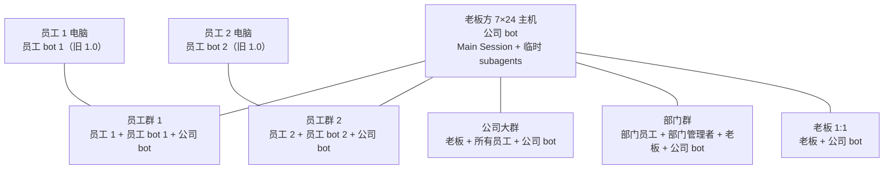
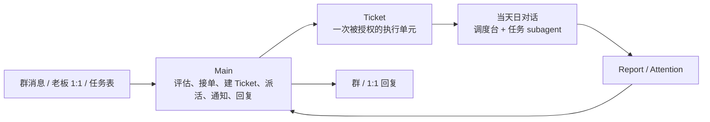

# 未来发展设计（现阶段）

> 类型：方向（master，设计树）

> 状态：设计 v0.8 · 2026-11-10（主干 0/1/2/3 已收口；主干 2 ACC-16、主干 3 ACC-13/14/15 真实群通过）
>
> **这份文档描述“要建成什么”，不是“现在已经有什么”。** 现状以 [ARCHITECTURE.md](./ARCHITECTURE.md)、[module-map.json](../module-map.json) 和 [modules/](./modules/) 为准；状态以 [STATUS.md](./STATUS.md) 为准；两者冲突时，先改设计/账本，再改代码。
>
> **读法：这是一棵设计树。**
> - **主干**：你对项目的一个核心想法，尽量保留你的原话。
> - **分支**：我们讨论后落成的设计决定。
> - **叶子**：还没定的问题，集中在第 6 节，不替你编。
>
> 参考：DeepSeek Harness 的 [dsh-superagent 原型](https://github.com/deepseek-ai/dsh-superagent-prototype)（`000-philosophy` / `001-domain` / `003-execution` / `004-prompts`），以及 OpenAI《The Future of the Firm》里 “between us” 的组织位置。借的是模型，不是代码。

**一句话**：把公司 bot 做成老板与员工之间的 between-us 层——接住公司里的任务，自己排期、自己执行，只在人必须行动或能使用结果时说话。

**已定 / 未定**：

- 已定：两层结构、Task/Ticket/Assignment、确认协议、老板唯一/管理者按部门、四类群、公司大群可答公司级+部门级、P0/P1/P2/P3 排期、只有 Main 对人说话；executor 本机实现已落。
- 常驻：主干 0 本批已收口（2026-11-09）；零缺口且 ACC 通过才 ✅，新缺口自动重开。
- 已定：老板 1:1 用真 1:1（D32，不建私有群）；公司群/老板 1:1 已验（D35）；员工群/部门群 chatId 未入本机账本，ACC-08 按 D36 书面例外。
- 已定（主干 3，D40–D44）：确认走短号 `A12` 为主、引用文本增强；Attention 通知走 outbox；`require_ack` 默认关 + 三类开；2h/8h/24h 升级；通知按 purpose 找人、优先私密。
- 待设计：员工 bot 的本地执行 / 离线行为、handoff（归主干 4）；WorkBuddy 执行器适配已落本机。

## 设计树总览

```text
项目
├─ 主干 0：收尾、清债与现状修正（常驻）
│  ├─ 0.1 Bug / 回归
│  ├─ 0.2 技术债 / 重构
│  ├─ 0.3 文档 / 契约缺口
│  ├─ 0.4 运维 / 部署缺口
│  ├─ 0.5 安全 / 合规
│  ├─ 0.6 测试 / 覆盖缺口
│  ├─ 0.7 设计反哺 / 现状修正
│  └─ 0.8 真实环境验收（批次，不计入分支数）
├─ 主干 1：两种部署、四类参与者、四类群
│  ├─ 分支 1.1 谁部署在哪
│  ├─ 分支 1.2 群模型与成员
│  ├─ 分支 1.3 隐私路由与老板 1:1
│  ├─ 分支 1.4 任务请求与权限
│  └─ 未定项（见 6.1，不计入分支数）
├─ 主干 2：公司 bot 是 super-agent，自己看任务、自己干
│  ├─ 分支 2.1 Main：入站、判断与派活
│  ├─ 分支 2.2 Executor：会话、工作区与适配器
│  ├─ 分支 2.3 工作模型与生命周期
│  ├─ 分支 2.4 调度与资源控制
│  ├─ 分支 2.5 执行安全、恢复与审计
│  └─ 未定项（见 6.2，不计入分支数）
├─ 主干 3：between us，先自主完成，再通知人
│  ├─ 分支 3.1 三种需要人的情况
│  ├─ 分支 3.2 群回复确认协议
│  ├─ 分支 3.3 谁有资格确认、责任怎么交
│  ├─ 分支 3.4 通知谁才是对的
│  ├─ 分支 3.5 一条完整的链
│  └─ 未定项（见 6.3，不计入分支数）
├─ 主干 4：员工 bot（部分已定）
│  ├─ 分支 4.1 群与对话边界
│  ├─ 分支 4.2 身份与补丁
│  ├─ 分支 4.3 职责范围
│  ├─ 分支 4.4 本地执行 / 离线
│  └─ 未定项（见 6.4，不计入分支数）
├─ 横切规则 A：权限与可见性
├─ 横切规则 B：排期与抢占
└─ 横切规则 C：失败、恢复、审计
```

### 进度标记规则

每个分支标题带 `设计 / 实现` 状态，验收状态统一看进度总表的“验收”列。

- `✅` 完成；`🟡` 进行中/待验收；`⬜` 未开始；`⏸` 被叶子卡住；`—` 不适用/未到验收。
- **设计完成**：这个分支要做的决定已经拍板，写进文档。
- **实现完成**：代码、测试、部署/文档引用都落地。
- **验收完成**：需要真实群/凭据/主机的分支，`STATUS §3.5` 的 ACC 批次通过；不需要真实验收的分支用 `—`。
- **主干完成**：所有计入分支的**设计 ✅ + 实现 ✅ + 验收 ✅/—** 三者齐全。只有设计全 ✅ 标 `设计 ✅ / 实现 ⬜`；有分支没定标 🟡；全没开始标 ⬜。
- 树里的“未定项”是叶子入口，**不计入分支数**；不要在总表里再算一遍。
- 改一个分支时，同步改本节总表和主干标题；不要只改标题、不改汇总。
- **不要把“讨论过”当成“实现完成”，也不要把“本地测试通过”当成“验收完成”。**

### 进度总表

| 主干 | 分支 | 设计 | 实现 | 验收 | 说明 |
|---|---|---|---|---|---|
| 0 | 0.1 Bug / 回归 | ✅ | ✅ | — | 本批收口：212/212×3 + 部署脚本 6 处缺陷修复（GAP-068）；常驻 |
| 0 | 0.2 技术债 / 重构 | ✅ | ✅ | — | 边界 0 违规/0 深导入；补 executor 部署映射与 deploy -Rollback 实现；常驻 |
| 0 | 0.3 文档 / 契约缺口 | ✅ | ✅ | — | 全量同步计数/状态/例外（GAP-066/067、D35/D36）；常驻 |
| 0 | 0.4 运维 / 部署缺口 | ✅ | ✅ | — | 部署 11/11、13 任务、补丁、备份/恢复/回滚演练均通过；常驻 |
| 0 | 0.5 安全 / 合规 | ✅ | ✅ | — | check-public 零输出、secrets ACL PASS、D28/D29/D36 记录 |
| 0 | 0.6 测试 / 覆盖缺口 | ✅ | ✅ | — | 212/212×3、覆盖 90.83/80.43/94.99；员工侧按 D35 用户实测 |
| 0 | 0.7 设计反哺 / 现状修正 | ✅ | ✅ | — | 关 007/008/010/023/026/027/035/057/060/062/063/064；034/053/070 已落，071 归主干 2 后续 |
| 0 | 0.8 真实环境验收 | ✅ | ✅ | ✅ | ACC-07/09/10/11 本机达成；ACC-01/02/03/04/05/06/12 用户实测通过（D35）；ACC-08 人工对账书面例外（D36） |
| **0** | **主干 0 汇总（常驻）** | **✅** | **✅** | **✅** | 本批收口完成（2026-11-09）；常驻机制保留，新缺口自动重开 |
| 1 | 1.1 谁部署在哪 | ✅ | ✅ | ✅ | 公司主机 + 员工电脑均已部署；员工 bot 仍是旧 1.0，归主干 4 |
| 1 | 1.2 群模型与成员 | ✅ | ✅ | ✅ | 四类群真实链路按 D35 用户实测；本机 org 只登记公司群/boss_dm，ACC-08 为 D36 例外 |
| 1 | 1.3 隐私路由与老板 1:1 | ✅ | ✅ | ✅ | router/chat_id 已落；老板 1:1 用真 1:1（D32），D35 用户实测通过 |
| 1 | 1.4 任务请求与权限 | ✅ | ✅ | ✅ | 同部门/跨部门请求按 D35 用户实测通过；CLI/persona/通知链已落 |
| **1** | **主干 1 汇总** | **✅** | **✅** | **✅** | 4/4 设计+实现+验收收口；D35 用户实测、D36 例外 |
| 2 | 2.1 Main：入站、判断与派活 | ✅ | ✅ | — | 技能 + brief/candidates/evaluate CLI；确认解析归主干 3 |
| 2 | 2.2 Executor：每日对话与任务 subagent | ✅ | ✅ | ✅ | executor 6 表/17 CLI/skill 已落；ACC-09/10/11 本机达成 |
| 2 | 2.3 工作模型与生命周期 | ✅ | ✅ | — | Task↔Ticket 单向终止（D38）、failed 自动重试至 max_attempts；拆分不做 |
| 2 | 2.4 调度与资源控制 | ✅ | ✅ | — | 4+1 slot/队列/EDF；默认 30m/3/default；超预算中断（D39） |
| 2 | 2.5 执行安全、恢复与审计 | ✅ | ✅ | ✅ | 幂等/恢复/审计已落；ACC-11 真实窗口重启 recover 通过 |
| **2** | **主干 2 汇总** | **✅** | **✅** | **✅** | 5/5 分支设计+实现收口；ACC-09/10/11 本机达成；ACC-16 真实 Main 群全链路通过（2026-11-10） |
| 3 | 3.1 三种需要人的情况 | ✅ | ✅ | — | 已定；入口/状态映射见 D43 |
| 3 | 3.2 群回复确认协议 | ✅ | ✅ | — | 短号为主 + 引用文本增强（D40） |
| 3 | 3.3 谁确认、责任怎么交 | ✅ | ✅ | — | 严格 required_confirmer + 老板；`require_ack` 三类开（D40/D42） |
| 3 | 3.4 通知谁 | ✅ | ✅ | — | 按 purpose 找人 + 私密优先（D44） |
| 3 | 3.5 完整示例 | ✅ | ✅ | — | 示例已按 A12 / human slot 更新 |
| **3** | **主干 3 汇总** | **✅** | **✅** | **✅** | 5/5 设计+实现；ACC-13/14/15 真实群通过 |
| 4 | 4.1 群与对话边界 | ✅ | ⬜ | — | 只在员工群；只有员工本人对话 |
| 4 | 4.2 身份与补丁 | ✅ | ⬜ | — | 员工侧要打补丁，保证交接归属 |
| 4 | 4.3 职责范围 | 🟡 | ⬜ | — | 本地资料/交接；不查公司库 |
| 4 | 4.4 本地执行 / 离线 | ⬜ | ⬜ | — | 待设计 |
| **4** | **主干 4 汇总** | **🟡** | **⬜** | **—** | 2/4 分支设计 ✅ |
| A | 5.1 权限与可见性 | 🟡 | ⬜ | — | 隐私/身份映射待定 |
| B | 5.2 排期与抢占 | ✅ | ⬜ | — | 已定 |
| C | 5.3 失败、恢复、审计 | 🟡 | ⬜ | — | 超时/员工离线待定 |
| **—** | **横切汇总** | **🟡** | **⬜** | **—** | 1/3 分支设计 ✅ |

## 0. 主干 0：收尾、清债与现状修正（常驻）｜设计 ✅ · 实现 ✅ · 验收 ✅

> 收开发过程中留下的 bug、技术债、文档/契约/运维/安全/测试缺口，也收**未来主干反过来修正现阶段项目**的欠账。它不是功能主干，不占正常主干顺序；在功能主干之间、发版前、或积压到阈值时开批次。
>
> **2026-11-10 复检**：开放 GAP=0（trunk-4 项移出；079/080/071 接受）；非提权 doctor 改为 WARN，不再假 FAIL。

### 0.1 分支

| 分支 | 收什么 | 完成条件 |
|---|---|---|
| **0.1 Bug / 回归** | 线上/测试暴露的错误、回归、偶发失败 | 该类开放 `GAP` = 0 |
| **0.2 技术债 / 重构** | 临时写法、重复实现、该拆没拆的模块 | 该类开放 `GAP` = 0 |
| **0.3 文档 / 契约缺口** | 文档与代码不一致、缺契约、断链、过期入口 | 该类开放 `GAP` = 0 |
| **0.4 运维 / 部署缺口** | 部署、任务、ACL、备份、重建里的欠账 | 该类开放 `GAP` = 0 |
| **0.5 安全 / 合规** | 注入、冒用、凭据、许可证、第三方归属 | 该类开放 `GAP` = 0 |
| **0.6 测试 / 覆盖缺口** | 没测到的关键路径、flake、夹具缺失 | 该类开放 `GAP` = 0 |
| **0.7 设计反哺 / 现状修正** | 未来主干纠正旧行为、旧契约、旧表结构、旧文档 | 该类开放 `GAP` = 0 |
| **0.8 真实环境验收** | 需要真实群、真实凭据、真实主机、现场动作的验收 | 统一收尾批次通过；不能靠本地测试替代 |

### 0.2 规则

1. **阻断当前主干代码/设计验收的缺陷，不能推给主干 0。** 必须在当前主干修完；真实环境验收项按 0.8 后置，不属于这一类。
2. 每个缺口在 `STATUS.md` 有 `GAP-###`：类型、严重度、来源主干、是否阻塞、下一步。
3. 功能主干完成时做一次收尾：剩余缺口逐条决定——立即修 / 进主干 0 / 明确接受不修。
4. 主干 0 的批次由 `PLAN.md` 选一批 `GAP` 编号，不写“把所有 bug 修完”。
5. 严重度：`S0` 立即处理；`S1` 下一批优先；`S2/S3` 排期或接受。
6. **需要真实群/凭据/主机的验收项不阻塞推进**：遇到就登记为 `0.8` 验收项（`STATUS` §3.5），继续做能做的；不要停下来等环境。
7. **统一收尾**：功能主干代码完成后，按 `STATUS` §3.5 的 ACC 批次一次跑真实验收；验收通过前主干保持 🟡 待验收，不能标 ✅。
8. **验收项不能拿本地测试冒充**：本地 `npm test` 通过只证明代码，不证明真实群/账号/部署已通。
9. **主干 0 的完成状态 = 当前开放缺口为 0。** 新缺口进来，对应分支和主干 0 自动回到 🟡。
10. **未来主干修正现状时，修正项必须登记到 `STATUS` 的“设计反哺”清单**，写清旧行为 / 目标行为 / 影响文件或契约 / 回归测试；阻断当前主干的修正当前做，不阻断的进 0.7。
11. **不允许在新主干里静默改掉旧行为**：旧表、旧 CLI、旧文档、旧契约被新设计取代时，要么保留兼容层并标注，要么登记 0.7 收口。
12. **每次讨论形成结论、或完成一个任务/主干后，做一次主干 0 复检**：逐项看 0.1–0.8，有新增/关闭就更新 `STATUS` 的 `GAP`；没有变化也留一行“已核对无变化”。复检记录写在 `STATUS` §3.4。
13. **完成即更新**：任何“完成”都要按 `STATUS` §3.6 更新 `GAP`、分支/主干进度、`PLAN`、文档审计和测试数；只改代码/文档、不改账本，不算完成。
14. **文件驱动**：聊天只用于讨论；结论必须落到 `STATUS` / `PLAN` / `FUTURE-DESIGN` / 模块契约。文件是跨会话唯一记忆，没落盘等于没发生。

### 未定项（叶子，不计入分支）

- 主干 0 批次的触发阈值（积压多少条、多久一次）。
- 谁有权决定“接受不修”；接受后是否永久关闭还是定期重看。
- `S2/S3` 缺口的默认保留期。

## 1. 主干 1：两种部署、四类参与者、四类群｜设计 ✅ · 实现 ✅ · 验收 ✅（D35/D36）

> **你的原话（转述）**：员工电脑会部署这个项目；一台 7×24h 的主机（老板方）部署这个项目。会有这些角色：公司 bot、员工 bot、老板、管理者、员工。最初想的是两种群：员工群（一个员工 + 他的员工 bot + 公司 bot）和公司大群（老板 + 所有员工 + 公司 bot）。
>
> **2026-11-07 补充**：一个老板 + 多个管理者（按部门范围）；新增**部门群**（该部门员工 + 该部门管理者 + 老板 + 公司 bot）；公司大群可以回答公司级和任意部门级；部门级 = 全员可见，个人级/内部级才走私密。

### 1.1 谁部署在哪｜设计 ✅ · 实现 ✅ · 验收 ✅（D35；员工 bot 旧 1.0）

| 角色 | 部署位置 | 职责 | 不做什么 |
|---|---|---|---|
| **老板** | 企业微信；老板方主机的公司 bot | 全局派活、审批、看全局、停任务、改优先级；P0 | 不直接改数据库、不直接操作 Executor 会话 |
| **管理者** | 企业微信；本人电脑的员工 bot + 部门群 | 管理一个或多个部门；本部门派活/确认/改派；P1 | 不跨部门管理；无独立私聊；不能代确认 |
| **员工** | 企业微信；员工电脑 | 在自己的员工群提需求、确认、看结果；P2 | 不跨员工看数据、不进别人的员工群 |
| **公司 bot** | 老板方 7×24 主机 | Main Session（群交互/评估/派活）+ 每任务一个临时 subagent | 不在群里干长活；不替员工 bot 做本地执行 |
| **员工 bot** | 员工电脑 | **旧 1.0 已部署**；本地资料/交接设计归主干 4，不查公司库 | 不进部门群/公司大群；只在员工群服务本人 |



**一个关键事实**：老板没有独立的员工 bot，**公司 bot 兼任老板的个人 bot**。

### 1.2 群模型与成员｜设计 ✅ · 实现 ✅ · 验收 ✅（D35；ACC-08 例外 D36）

| 交互面 | 类型 | 成员 | 公司 bot 的定位 | 可见性 |
|---|---|---|---|---|
| **员工群** | `employee` | 该员工 + 他的员工 bot + 公司 bot | 参与员工日常协作；员工 bot 也在 | 仅该员工 |
| **部门群** | `department` | 该部门员工 + 该部门管理者 + 老板 + 公司 bot | 部门协作、部门数据；知道 `dept_id` | 该部门 + 老板 |
| **公司大群** | `company` | 老板 + 所有员工 + 公司 bot | 公司级 + 部门级直接答；员工 bot 不在 | 全公司 |
| **老板 1:1** | `boss_dm` | 老板 + 公司 bot | 老板私有控制台 | 仅老板 |

规则：

- 老板不进员工群；员工 bot 不进部门群、公司大群。
- 公司 bot 同时在员工群、部门群、公司大群、老板 1:1；用 `groups.type` + `groups.dept_id` 识别场景。
- 部门群成员 = 该部门员工 + 该部门所有管理者 + 老板 + 公司 bot；管理者管多个部门 → 在多个部门群。
- 公司大群成员 = 老板 + 全体员工 + 公司 bot。
- 老板 1:1 优先用真 1:1；不可用时退化成“老板 + 公司 bot”的私有群，类型仍是 `boss_dm`。
- 群成员以 org 为准；企微群成员只做校验，不一致告警，不自动踢人。
- **只有 Main Session 说话**；员工 bot 只在员工群说话，不进部门/公司群。

### 1.3 隐私路由与老板 1:1｜设计 ✅ · 实现 ✅ · 验收 ✅（D35；D32 真 1:1）

**原则**：公司级、部门级可以在公司大群直接答；个人级、内部/老板级走私密渠道。**部门级不是保密级**——它在公司大群是全员可见；要保密必须标成个人级或内部级。

| 数据级别 | 公司大群 | 部门群 | 员工群 | 老板 1:1 |
|---|---|---|---|---|
| **公司级** | ✅ | ✅ | ✅ | ✅ |
| **部门级** | ✅ 全员可见 | ✅ 本部门优先；任意部门也可见 | ✅ 本部门；任意部门也可见 | ✅ |
| **个人级** | ❌ 转本人私密渠道 | ❌ 转本人私密渠道 | ✅ 本人 | ✅ |
| **内部/老板级** | ❌ | ❌ | ❌ | ✅ |
| **不确定** | ❌ 默认私密 | ❌ 默认私密 | ✅ 本人员工群 | ✅ |

规则：

- 公司大群可以答任意部门级；部门级数据在公司群就是全员可见。敏感数据不要标部门级，标个人级/内部级。
- 有权限但渠道不对 → 换私密渠道回答，不拒绝；没权限 → 明确说“这个我没有权限”，不泄露。
- 老板在公司群问个人数据也转 1:1；老板可以要求“公司级摘要”在群里说。
- 老板 1:1 是最高权限控制台；D32 已定不建私有群 fallback，主动推送不做承诺。

### 1.4 任务请求与权限｜设计 ✅ · 实现 ✅ · 验收 ✅（D35）

**角色与优先级**：

| 角色 | 数量 | 范围 | 优先级 |
|---|---|---|---|
| 老板 `boss` | 唯一 | 全公司 | P0 |
| 管理者 `manager` | 多个 | 一个或多个部门 | P1 |
| 员工 `employee` | 多个 | 自己 | P2 |
| 系统/主动 | — | 规则 | P3 |

**任务来源与状态**：

```text
老板/管理者直接派 → open
员工给自己建       → open
同部门请求         → pending_acceptance → 接受 open / 拒绝 rejected
跨部门请求         → pending_approval → 管理者批准 → pending_acceptance
                                    → 管理者拒绝 → rejected
                                    → 接受 open / 拒绝 rejected
```

规则：

- 同部门请求：直接到 B，B 接受即可；B 的管理者可见，但不审批。
- 跨部门请求：先到 **B 所在部门的任一管理者** 审批；老板可覆盖；批准后 B 接受。
- A 的管理者只读可见，不参与审批。
- B 在管理者批准前不进入“待接受”列表，也不应收到通知；批准后才进入“待接受”。
- 老板/管理者可以代接受、代拒绝、改派；记录操作人。
- 拒绝必须带原因；`rejected` 与 `cancelled` 分开。
- 优先级仍是 P2（员工发起）；管理者接手/改派后才升 P1。
- 超时：先提醒操作人 + 其管理者，再升级老板；**不自动拒绝**。

**权限矩阵**：

| 动作 | 老板 | 管理者 | 员工 |
|---|---|---|---|
| 给自己建任务 | ✅ | ✅ | ✅ |
| 直接派给下属 | 任何人 | 本部门 | ❌ |
| 请求同事 | ✅ | ✅ | ✅（同部门直接；跨部门走审批） |
| 代接受/拒绝 | 任何 | 本部门 | ❌ |
| 改派 | 任何 | 本部门 | ❌ |
| 取消 | 任何 | 本部门 | 自己的 |
| 代确认 `on_behalf_of` | ✅ | ❌ | ❌ |

### 未定项（叶子，不计入分支）

- 老板 1:1：D32 已定用真 1:1；私有群 fallback 不做。
- 企微实际群成员对账：本地 org→DB 同步已完成；ACC-08 采用人工对账书面例外（D36），API 对账不做。
- 隐私分级怎么标：谁给 vault/任务打 `公司级/部门级/个人级/内部级` 标签；router 已有，标注没有。
- 任务审批/接受的超时时长与升级路径。
- 部门群创建/维护；管理者管多个部门、部门无管理者时的边界。
- 旧 `chat_bindings` 的长期策略：兼容层保留多久、何时只读/清理（回填工具已有）。
- 员工 bot 的补丁/移除查库是主干 4 的依赖（GAP-037–039）。

## 2. 主干 2：公司 bot 是 super-agent，自己看任务、自己干｜设计 ✅ · 实现 ✅ · 验收 ✅（2026-11-10）

> **你的原话（转述）**：公司 bot 像 DSH 的 super-agent，自己看到有任务，自己去干。比如任务表里有一条 background 任务 → bot 自己发现 → 自己排期 → 自己去干 → 干完报。
>
> **2026-11-08 分支重构**：按“变更原因”拆成 Main / Executor / 工作模型 / 调度 / 执行安全。原“双工作区”并入 Executor，原“状态”并入工作模型；不新增功能，只把边界切清。

### 2.1 Main：入站、判断与派活｜设计 ✅ · 实现 ✅（brief/evaluate）

Main 是唯一对人说话的层；它决定“这是不是活、要不要接、派给谁”，但不执行长任务。



**职责**

- 接收员工群、部门群、公司大群、老板 1:1 的消息；先跑 `bind actor` 拿群类型/角色/部门。
- 判断：这是不是活、谁在要、有没有权限、是不是重复、要不要接。
- 建/更新 Task；决定是否建 Ticket；把 Ticket 放进调度队列。
- 把 Executor 的 Report / Attention 转成人话，发到正确的群或 1:1。
- 回答状态查询、处理确认、停任务、改优先级。

**约束**

- **不干长活**：不在 Main 里跑长时间 shell、写大文件、做完整交付。
- **不等待**：发出派活后结束当前回合；报告和确认作为新消息回来。
- **不碰执行现场**：不直接改 Executor 的会话/工作文件；Ticket/Assignment 的状态由命令和 Report 驱动。
- **不做确认解析**：`required_confirmer`、引用/短号/@ 解析属于主干 3；Main 只创建和发出 Attention。

### 2.2 Executor：每日对话与任务 subagent｜设计 ✅ · 实现 ✅ · 验收 ✅

**核心模型**

```text
一个 WorkBuddy 登录
└─ 当天对话（调度台）
   ├─ Task 1 [部门 A] → subagent 1 → departments/A/tasks/<ticket>/
   ├─ Task 2 [部门 B] → subagent 2 → departments/B/tasks/<ticket>/
   └─ Task 3 [部门 A] → subagent 3 → departments/A/tasks/<ticket>/
```

- **一天一条对话**：日对话是调度台，不是任务执行器；每天新开，旧对话只留交接摘要。
- **一个任务一个 subagent**：不按部门拆 subagent 类型；部门只是任务的标签和输出路由。
- **任务必须带 `department_id`**：Main 建 Task/Ticket 时写明；subagent 不需要自己判断部门。
- **产物按部门落盘**：`departments/<dept_id>/tasks/<ticket_id>/`；日对话只收 Report 和摘要。
- **任务状态在数据库**：日对话是 UI/上下文边界；换对话不丢任务、队列和 Report。

> **参考 `upstream:dsh-superagent`**：它用“一 Ticket 一 Executor Session + 一个目录”做隔离，并用 worker slots 控制并发。我们的 WorkBuddy 路线无法稳定维持多个 live 会话，所以改为“日对话 + 临时 subagent”；仍沿用 Ticket/Assignment/Report、worker slot、工具边界和“先落库再动作”，不照搬它的 Session 实现。

**执行流程**

1. Main 接任务，确定 `department_id`、优先级、授权范围、输出目录。
2. 建 Task/Ticket；Ticket 的部门、基目录、工具/预算不可变。
3. 调度台看全局空槽；有空位就起一个 subagent，把 Ticket、任务目录、工具边界、Report 格式交给它。
4. 没空位就排队；P0 排到队首，但不自动抢占正在跑的 subagent；同优先级 FIFO。
5. subagent 在自己的任务目录工作，写产物、证据、Report；不直接进群。
6. 调度台收 Report，更新 Ticket/Assignment，发通知或起下一个任务。
7. 03:00 日切：新开日对话接新任务；旧对话进入 `closing`，不再接新任务，但运行中的 Assignment 继续写 Report；交接摘要写 `days/<date>.md`。

**目录约定**

```text
<root>/
├─ departments/
│  ├─ <dept_id>/
│  │  ├─ shared/                 # 部门共享资料，任务只读
│  │  ├─ tasks/<ticket_id>/      # 该任务产物、日志、证据
│  │  └─ days/<date>.md          # 部门日交接摘要
│  └─ ...
└─ vault/                        # 共享只读区
```

- **一个部门多个任务**：同一部门也走同一个队列和全局并发槽；不需要多开对话。
- **部门隔离**：采用逻辑隔离（D28）：目录约定 + tool 路径白名单；不是 OS 强沙箱；专用账号/ACL 留作部署选项。
- **共享文件**：任务默认只读；要改走单独的 ingest/merge 流程，避免两个 subagent 互相覆盖。
- **一个嘴巴**：subagent 不直接进群、不直接 @ 人；所有对人说话都经 Main。

**日切（每天 03:00）**

- 03:00 新 host 进入 `active`，开始接新任务；旧 host 进入 `closing`，`accepting_new=false`，不再接新任务。
- 旧 host 已启动的 subagent 不因日切被主动杀掉；完成后把 Report 写回数据库。
- 旧 host 运行中的 Assignment 保持 `running`；新 host 看到 `running` 就不重复派同一个 Ticket。
- 旧 host 写 `days/<date>.md` 交接摘要：未完成任务、排队任务、运行中 Assignment、产物路径。
- 如果旧对话被关闭/平台无法让它继续运行：超过 grace（默认 10 分钟）后把 Assignment 标为 `interrupted`；新 host 用同一 Ticket、同一任务目录、上次 Report 重新起 subagent，不重复已完成的外部动作。
- 新任务只进新 host；旧 host 只负责收尾，不接新活。
- **2026-11-09 用户实测通过**：日切后旧对话运行中的任务继续，新对话同时接新任务；不再需要把“旧 host 是否继续”当阻塞项。

**并发与恢复**

- 全局并发上限先按 4；每个 subagent 一个任务，不按部门另设 subagent 类型。
- **2026-11-09 并发/落盘 spike 通过**：4 个 subagent 同时运行（最早 start 02:24:24，最晚 finish 02:24:38；4 条时间窗重叠），销售 2 任务、财务 2 任务各自只写 `departments/<dept>/tasks/<ticket>/`，没有串写。
- 并发上限、模型选择、预算、重试上限待定（6.2 #9）。
- 主机重启后，按 Ticket/Assignment 恢复；subagent 是临时执行体，不把“会话 id”当任务身份。
- 日对话被关闭/换日不阻塞任务：Report 写回数据库，下一班调度台接管；旧 host 只收尾，不接新任务。

**约束**

- **不能直接对人说话**：没有 `ask_user_question`、没有群发、没有 @。
- **不能改授权/额度/优先级**；只能使用 Ticket 授权的工具、路径和预算。
- **不能开新的 WorkBuddy 对话**；任务只在当天调度台里以 subagent 运行。
- 交接给人时释放槽；人回复后，同一 Ticket 恢复。

### 2.3 工作模型与生命周期｜设计 ✅ · 实现 ✅（D38）

| 概念 | 定义 | 关键字段 | 谁写 |
|---|---|---|---|
| **Task** | 人可见的“要做什么” | `task_id`、标题、交办人、执行人、群、`department_id`、截止时间、优先级、状态 | Main |
| **Ticket** | 一次被授权的执行单元；一个 Task 可以有多张 Ticket（重做/恢复） | `ticket_id`、`task_id`、`department_id`、授权范围（工具/路径/预算/有效期/最大尝试）、状态、创建原因 | Main |
| **ExecutorHost** | 当天的 WorkBuddy 调度对话；03:00 日切 | `host_id`、日期、conversation_id、状态（active/closing/closed）、`cut_at`、`accepting_new`、开始/结束 | Main / runtime |
| **Assignment** | 一次具体的执行尝试；一个 Ticket 可以有多次 Assignment | `assignment_id`、`ticket_id`、`host_id`、`subagent_id`、`department_id`、任务目录、开始/结束、结束原因 | Main / subagent 事实回报 |
| **Report** | subagent 对一次执行的回报 | `report_id`、`assignment_id`、`department_id`、类型、摘要、证据、下一步 | subagent |
| **Attention** | 需要人行动的一条待确认 | `attention_id`、`short_code`、`ticket_id`、目的、问题、选项、`required_confirmer_id`、`require_ack`、状态、回复消息 id | Main |
| **Notification** | 一条对外通知/回复 | `notification_id`、目标（群/1:1）、目的、关联 Task/Ticket/Attention、状态 | Main |
| **Thread** | 一个群或 1:1 的会话上下文 | `chat_id`、类型、成员、绑定 | 平台适配层 |

**为什么分三层**

- Task 是人看的；人可以改标题、改截止、取消，不需要知道 Ticket。
- Ticket 是授权/执行单位；同一个人可见任务可以重做、恢复，不重复建 Task。
- Assignment 是一次尝试；失败重派、换会话，不影响 Task/Ticket 的身份。

**Ticket 授权范围（必须显式）**

- `tools`：允许调用的工具/技能白名单。
- `vault_paths`：允许读写的 vault 路径；默认只读。
- `budget`：token/时间/金额上限；超限即 `blocked`，不静默继续。
- `expires_at` / `max_attempts`：过期与重试上限。
- 没有授权范围的 Ticket 不允许 Executor 启动。

**表结构（已落：`src/core/schema.ts`；2026-11-09 本机部署验证）**

> 形状和约束已写入 schema / 迁移；现有 `tasks` 是人类可读的 Task；`tickets` 是执行单位，不替代 `tasks`。

```sql
CREATE TABLE IF NOT EXISTS executor_hosts (
  host_id         TEXT PRIMARY KEY,
  business_date   TEXT NOT NULL,          -- 03:00 起算的工作日 YYYY-MM-DD
  conversation_id TEXT NOT NULL,          -- WorkBuddy 日对话 id
  status          TEXT NOT NULL,          -- active | closing | closed
  accepting_new   INTEGER NOT NULL DEFAULT 1,
  cut_at          TEXT NOT NULL,          -- 下一个 03:00
  cut_deferred    INTEGER NOT NULL DEFAULT 0,
  cut_deferred_at TEXT,
  started_at      TEXT NOT NULL,
  closed_at       TEXT,
  last_heartbeat_at TEXT
);

-- 全局同一时间只允许一个 active host
CREATE UNIQUE INDEX IF NOT EXISTS ux_executor_hosts_active
  ON executor_hosts(status) WHERE status = 'active';

CREATE TABLE IF NOT EXISTS tickets (
  ticket_id       TEXT PRIMARY KEY,
  task_id         INTEGER NOT NULL REFERENCES tasks(id),
  department_id   TEXT NOT NULL,          -- 部门标签，创建后不可变
  title           TEXT NOT NULL,
  state           TEXT NOT NULL,          -- queued | working | waiting_trigger |
                                          -- waiting_answer | waiting_review | waiting_ack |
                                          -- blocked | failed | done | cancelled
  priority        TEXT NOT NULL DEFAULT 'P2',
  due_at          TEXT,
  task_dir        TEXT NOT NULL,
  tools_json      TEXT NOT NULL DEFAULT '[]',
  vault_paths_json TEXT NOT NULL DEFAULT '[]',
  budget_json     TEXT,
  expires_at      TEXT,
  max_attempts    INTEGER NOT NULL DEFAULT 3,
  latest_report_id TEXT,
  created_at      TEXT NOT NULL,
  updated_at      TEXT NOT NULL,
  ended_at        TEXT
);

CREATE INDEX IF NOT EXISTS idx_tickets_state ON tickets(state, priority, created_at);

CREATE TABLE IF NOT EXISTS assignments (
  assignment_id   TEXT PRIMARY KEY,
  ticket_id       TEXT NOT NULL REFERENCES tickets(ticket_id),
  host_id         TEXT NOT NULL REFERENCES executor_hosts(host_id),
  subagent_id     TEXT,                   -- WorkBuddy Agent 返回的 id；启动后填
  department_id   TEXT NOT NULL,
  task_dir        TEXT NOT NULL,          -- 创建时快照，不随日切改变
  slot            TEXT NOT NULL DEFAULT 'normal', -- normal | human
  state           TEXT NOT NULL,          -- pending | running | ended | interrupted | failed | cancelled
  attempt         INTEGER NOT NULL DEFAULT 1,
  report_id       TEXT,
  created_at      TEXT NOT NULL,
  started_at      TEXT,
  ended_at        TEXT,
  end_reason      TEXT
);

-- 一个 Ticket 同时只能有一个 active Assignment，防止旧/新 host 重复派活
CREATE UNIQUE INDEX IF NOT EXISTS ux_assignments_active_ticket
  ON assignments(ticket_id) WHERE state IN ('pending', 'running');
CREATE INDEX IF NOT EXISTS idx_assignments_host_state ON assignments(host_id, state);

CREATE TABLE IF NOT EXISTS reports (
  report_id       TEXT PRIMARY KEY,
  assignment_id   TEXT NOT NULL REFERENCES assignments(assignment_id),
  ticket_id       TEXT NOT NULL REFERENCES tickets(ticket_id),
  department_id   TEXT NOT NULL,
  type            TEXT NOT NULL,          -- progress | waiting | ready | blocked | failed | dropped
  summary         TEXT NOT NULL,
  evidence_json   TEXT NOT NULL DEFAULT '[]',
  next_step       TEXT,
  created_at      TEXT NOT NULL
);

CREATE INDEX IF NOT EXISTS idx_reports_ticket ON reports(ticket_id, created_at);

CREATE TABLE IF NOT EXISTS executor_events (
  id INTEGER PRIMARY KEY AUTOINCREMENT,
  kind TEXT NOT NULL,
  host_id TEXT, ticket_id TEXT, assignment_id TEXT,
  detail TEXT, created_at TEXT NOT NULL
);
```

**关键不变量**

- `tickets.department_id`、`tickets.task_id` 创建后不可变；改部门/改任务语义 = 新 Ticket。
- `assignments.host_id`、`assignments.task_dir` 创建后不可变；跨日切只能新建 Assignment，不改旧的。
- 一个 Ticket 同时只有一个 active Assignment；唯一索引兜底，调度器仍要先查再建。
- Ticket 的状态由 Report + 人的动作推进；不跟随 host 或 subagent 的存活状态。
- Report 只追加；`tickets.latest_report_id` 只指向最新一条，旧 Report 不覆盖。
- 03:00 日切：旧 host `active → closing`，新 host 建为 `active`；旧 host 的 running Assignment 不迁移，仍归旧 host。
- 新 host 只派 `tickets.state='queued'` 且没有 active Assignment 的 Ticket。
- 旧 host 超过 grace 仍无法回报：旧 Assignment `running → interrupted`；Ticket 保持/回到 `queued`，由新 host 新建 Assignment 重试。
- 旧 Assignment 的迟到 Report 只记录，不覆盖新 Assignment 的 Ticket 状态；外部副作用按幂等键去重。

**状态机**

Ticket 的状态由 Report/人的动作推进；Host/Assignment 的状态只影响调度，不反向覆盖 Ticket。

Task（人可见）：`open` → `in_progress` → `waiting_human` / `blocked` → `done` / `cancelled` / `needs_review`

Ticket（执行单元）：

| 状态 | 含义 |
|---|---|
| `queued` | 已授权，等 slot |
| `working` | subagent 正在跑 |
| `waiting_trigger` | 本轮结束、无待人工事项；等新消息/新 Assignment |
| `waiting_answer` | 等人回答（Attention） |
| `waiting_review` | 等人核查结果（ready Report） |
| `waiting_ack` | 等责任回执（`require_ack`） |
| `blocked` / `failed` | 执行受阻/失败，等人处理 |
| `done` / `cancelled` | 结束 |

Assignment：`pending` → `running` → `ended` / `interrupted` / `failed` / `cancelled`

ExecutorHost：`active` → `closing`（03:00）→ `closed`（无 running Assignment）；异常可直接 `closed`

Report：`progress` / `waiting` / `question` / `ready` / `blocked` / `failed` / `dropped`

Attention：`open` → `answered` / `approved` / `rejected` / `acked` / `notified` / `expired` / `cancelled`

Ticket 允许的迁移：

```text
queued          → working | cancelled
working         → waiting_trigger | waiting_answer | waiting_review |
                  waiting_ack | blocked | failed | done | cancelled
waiting_trigger → working（新消息/新 Assignment）| cancelled
waiting_answer  → working（人回答）| cancelled
waiting_review  → working（人续谈/重做）| done | cancelled
waiting_ack     → working（人回执）| done | cancelled
blocked/failed  → queued（重试/换 Assignment）| cancelled
done/cancelled  → 终态
```

Assignment 允许的迁移：

```text
pending → running | failed | cancelled
running → ended | interrupted | failed | cancelled
ended/interrupted/failed/cancelled → 终态（历史保留）
```

03:00 日切序列：

```text
旧 host: active → closing
新 host: 创建为 active
新任务: 只进新 host
旧 running Assignment: 仍归旧 host，继续跑
旧 host 无 running Assignment → closed
旧 Assignment 失联超 grace → interrupted → Ticket 回 queued → 新 host 新建 Assignment
```

Report 到 Ticket 的默认映射：`progress` 不改状态；`waiting` → `waiting_trigger`；`question` → `waiting_answer`；`ready` → `waiting_review`；`blocked` → `blocked`；`failed` → `failed`；`dropped` → `done`（记录原因）。

**attention 入口（D43）**：`attention create --purpose answer` 允许从 `working | waiting_trigger | waiting_answer` 推进 `waiting_answer`；`--purpose responsibility --require-ack` 允许从 `waiting_review | working` 推进 `waiting_ack`。`claim --slot human` 支持 `--ticket-id` 定向领取，human-slot Assignment 不计入 `max_attempts`。

**与主干 3 的边界**

- 主干 2 负责：Attention 的创建、存储、发出，`required_confirmer` 字段，回复消息 id 回写（有则记）。
- 主干 3 负责：确认人校验、短号/引用文本/@ 解析、代确认 `on_behalf_of`、确认后的状态推进。
- 主干 2 不实现“谁有资格确认”的 UI/话术；只提供数据和命令。

### 2.4 调度与资源控制｜设计 ✅ · 实现 ✅（D37/D39）

**来源**

1. **人在群里说**（员工群 / 部门群 / 公司大群 / 老板 1:1）→ Main 判断后建 Task。
2. **任务表里已有**（如 `background` 任务）→ runtime 轮询产生候选 → Main 评估是否接、何时接。
3. **主动发现**（后续）→ 规则或 agent 提议 → 先 `observe`，记录“本来会做什么”，人确认后再 `auto`。

**优先级（按发起人角色分层，不按执行人）**

| 层级 | 来源 | 说明 |
|---|---|---|
| **P0** | 老板发起 | 最高；老板可手动停/改任何任务 |
| **P1** | 管理者发起 | 本部门任务；管理者接手/改派后升到这里 |
| **P2** | 员工发起 | 员工群、员工 1:1、同部门/跨部门请求 |
| **P3** | 系统/主动发现 | 默认最低；只在空闲时跑，先 `observe` |

**同层排序**

1. 有截止时间的优先，按截止时间从早到晚；
2. 没有截止时间的排后面；
3. 都一样，按创建时间先来后到（FIFO）。

**抢占与队列**

- **不自动抢占。** 正在跑的 Executor 不会被新来的 P0 任务踢掉。
- P0 排到队首，等下一个 slot。
- 老板要立刻腾位置，显式“停掉某个任务”；记审计，不静默杀。
- 并发上限可配置；**固定预留 1 个“人工续谈”slot**；它不接新任务，只接现有 Ticket 的人工回复/续谈。
- 队列积压时按优先级+截止时间出队；不允许无限重试。

**接单规则**

- 群里的明确请求：Main 评估后接；员工可以发起请求，不能直接替别人派活（同部门直接接受，跨部门先审批）。
- `background` 任务：Main 评估后接，不自动接；谁授权、谁定优先级见 6.2 #8。
- 主动任务：先 `observe`，不直接 `auto`。

**资源控制**

- 并发 slot、模型选择、额度/预算、失败重试上限统一在这里定。
- 超出预算/并发 → 任务保持 `blocked` 或排队，不降级成“偷偷继续跑”。
- 与 `5.2 排期与抢占` 的关系：5.2 是策略摘要，2.4 是执行细节；冲突时以 2.4 为准并回写 5.2。

### 2.5 执行安全、恢复与审计｜设计 ✅ · 实现 ✅ · 验收 ✅（D28/D34/ACC-11）

**幂等与副作用**

- 每条对外消息走 outbox 的 `dedupe_key`；重复入队不重复发。
- 外部写入/工具调用必须带幂等键（`effect_key`）；没有幂等键的副作用默认标为“不可自动重试”。
- 重试只重放可幂等步骤；不可幂等步骤失败 → `blocked`，交人处理。

**崩溃与恢复**

- 主机重启/进程崩溃：`running` Assignment 标 `interrupted`；Ticket 回 `queued` 或 `blocked`，不盲目重跑。
- 恢复前先查已有副作用/产物，避免重复写 vault、重复发消息、重复调用外部 API。
- 超过 `max_attempts` 仍失败 → `failed`，通知交办人/老板，不无限重试。

**卡住与失败分类**

- 超时/无心跳 → `blocked` 或 `failed`；区分网络、模型、工具、权限、数据缺失。
- 需要人决策 → Attention；需要人接管 → `blocked` + 明确接手人。
- 失败报告必须带：失败阶段、最后成功步骤、已产生副作用、建议下一步。

**审计与可观测**

- 最小事件：Task/Ticket/Assignment 状态变化、Ticket 授权、Executor 启动/结束、Report、Attention、副作用键、人工接管。
- 审计字段：`actor`、`at`、`from_status`、`to_status`、`reason`、`effect_key`、`session_id`。
- 与 `5.3 失败、恢复、审计` 的关系：5.3 是横切摘要，本节是 Executor 的具体契约。

### 未定项（叶子，不计入分支）

- WorkBuddy 怎么启动/恢复/中断任务 subagent；host 会话 id、任务目录、并发、超时怎么管（6.2 #6）。
- 任务工作区 C 盘具体路径、命名、清理、备份、权限、产物保留（6.2 #7）。
- `background` 任务自动接还是 Main 评估；谁授权、谁定优先级（6.2 #8）。
- 员工能不能给另一个员工派活；大群派活算谁的 Task（6.2 #8 邻近问题）。
- Executor 并发上限、模型选择、额度/预算、失败重试上限；是否预留“人工续谈”slot（6.2 #9/#10）。
- Task / Ticket / Assignment 的基数与重试/重开/拆分语义（6.2 #26）。
- Ticket 授权范围字段的最终集合（6.2 #27）。
- Main↔Executor 的传输与投递语义（DB+tick 已选方向；at-least-once/幂等已定，6.2 #28）。
- Attention 与主干 3 的最终接口（6.2 #29）。
- 外部副作用幂等键的生成与保证级别（6.2 #30）。
- 产物/证据的保留、清理、权限（6.2 #31）。
- 主机重启后 Assignment/Ticket 的恢复语义（6.2 #32）。

## 3. 主干 3：between us，先自主完成，再通知人｜设计 ✅ · 实现 ✅（本机） · 验收 ✅（2026-11-09）

> **你的原话（转述）**：公司 bot 会先自主完成可处理的任务，再通知人类。通知目的分两类：一是让人类核查任务是否有误，二是将责任同步给人类。公司 bot 把自己能做的做完，遇到需要通知人类的地方去通知人类；通知完确认完再接着干活。公司 bot 要找对的人通知，通知谁才是对的、有效的。

DSH 的哲学是“take as little human attention as possible, and give as much value as possible”：只在人必须行动或能使用结果时说话。OpenAI 的 “between us” 则是把 AI 放在人与人之间做协调层，不是工具，也不是平级同事。合起来就是：**公司 bot 先干，干到需要人拍板/接手时，再找对的人，用最短的话说清楚。**

### 3.1 三种需要人的情况｜设计 ✅ · 实现 ✅

| 类型 | 目的 | 是否阻塞 | 对应状态 |
|---|---|---|---|
| **answer** | 需要人给一个决定/事实 | **阻塞** | `waiting_answer` |
| **review** | 结果做完了，请人核查 | **阻塞**（该 Ticket） | `waiting_review` |
| **responsibility** | 把责任/后续交给某人 | 默认**不阻塞**；`require_ack` 时阻塞 | `waiting_ack` |

**为什么 review 阻塞**：结果没被核查前，不能把“做完了”当事实对外说；Ticket 停在 `waiting_review`，Executor 释放 slot。

**为什么 responsibility 默认不阻塞**：通知的目的可能只是“这件事我做了/我交给谁了”，不需要对方立刻拍板；但标了 `require_ack` 的，必须回“收到/我接手”才算责任转移。

**入口与状态（D43）**：`answer` 由 Report `question` 进入 `waiting_answer`；`review` 由 `ready` 进入 `waiting_review`；`responsibility` 默认不改 Ticket（`notified`），标 `require_ack` 时由 `attention create` 推进 `waiting_ack`。`question` 是新 Report 类型，`MAIN-EXECUTOR` / `subagent.md` 同步。

### 3.2 群回复确认协议｜设计 ✅ · 实现 ✅

前提：**必须 @ 公司 bot**。

**主路径是短号**（D40）：`@公司bot A12 可以` / `A12 不行，原因是…` / `A12 收到`。短号 `A<seq>` 全局单调、不复用。

识别顺序：

1. **正文里的短号**（首选，零依赖）：`A12` → 唯一 Attention；
2. **引用文本里的短号**（增强）：用户引用一条带 `A12` 的通知，回 `@公司bot 可以`；从引用文本抠 `A12`，不依赖消息 id；
3. **当前人 + 当前群的唯一 open**：没短号、没引用时，只有一条 open 才执行；多条不猜。

`quote` 的消息 id 不作为主路径：补丁当前只注入 `chat/from`，文本引用的字段形状未实测，出站 webhook 也不保存消息 id（GAP-079）。T3.0 只做增强 spike，失败不阻塞。

每条 Attention 必须落库：

```text
attention_id, short_code, ticket_id, task_id, department_id,
purpose, question, options_json,
required_confirmer_id, require_ack, origin_chat_id,
status, answer_text, answered_by, on_behalf_of,
answer_message_id, notified_outbox_id,
remind_day, remind_count_today, remind_count, last_reminded_at, escalate_level,
created_at, answered_at, expires_at
```

**意图映射**：Main 把自然语言映射成 `answer|approve|reject|ack`，CLI 校验 purpose/action/state；`review` 的“可以/通过”= approve，“不行/重做”= reject，模糊就反问；`responsibility` 的“收到/我接手”= ack。

**歧义处理**：多条同时匹配时，bot 不发散、不猜，只问一句“你指的是 A12 报销，还是 A13 采购？”，最多列 3 条；用户下一条带短号再执行。原 Attention 继续按 2h/8h/24h 升级，不因反问而暂停。

### 3.3 谁有资格确认、责任怎么交｜设计 ✅ · 实现 ✅

- 每条 Attention 带 `required_confirmer_id`，必须落到具体人；角色在创建时解析成人，不存“某角色”。
- **只有 `required_confirmer` 或老板能确认**；本部门管理者不再代确认（D40；改 `canConfirmAttention`）。管理者可见、可催办，但 @ 了也只回“这条需要 XX 确认”。
- **老板最高权限**：可确认任何 Attention；记录 `answered_by=boss`、`on_behalf_of=<原确认人>`，并给原确认人发非阻塞通知。
- 老板在 1:1 的确认等同最高权限；在公司大群的确认同样有效，但默认不把个人数据贴到群里；结果按数据级别发回原群/私密。

**责任回执（D42）**

- 默认 `require_ack=0`：通知即记录，Attention 直接 `notified`，不进待办、不阻塞。
- 三类必须 `require_ack=1`：① 责任从公司 bot 转给具体人（接手人 ≠ 交办人）；② 跨部门交接；③ 对外/财务/生产变更。老板可显式覆盖。
- 标了 `require_ack` 的，必须回“收到/我接手”才算责任转移；Ticket 停在 `waiting_ack`，回执后 `done`。
- 没回执时责任仍算公司 bot：2h 提醒本人 → 8h 提醒本人部门管理者 → 24h 提醒老板；只提醒，不自动拒绝/转移；夜里顺延到工作时段。升级给管理者/老板的是**催办通知**，不是转移确认权；确认仍只认 `required_confirmer` / 老板。

### 3.4 通知谁才是对的｜设计 ✅ · 实现 ✅

**按 purpose 定人（D44）**：

| purpose | 第一收件人 | 兜底 |
|---|---|---|
| review | Task 交办人 | 老板 |
| answer | `required_confirmer`（Main 创建时指定，通常是最懂这个事实的人） | 交办人 → 老板 |
| responsibility | 接手人 | 老板 |
| progress | 不发，只进 `executor brief` | — |

“有效”的最低要求：目标人在职、有可用渠道、能看懂这条通知要什么、有权限行动。找不到合格的人时升级老板，不在群里刷屏。

**频道**：

- 优先私密：员工群（`resolvePrivateChat`）；私密群必须已配 webhook，否则视为不可用；
- **老板 1:1 不做主动推送（D32）**：公司/部门级回原群中性短号，内部级等老板问“待办”；
- 私密不可用 → 原群，只发短号 + 中性一句（如“A12 有一条待确认”），不带内容；内容仍走私密；
- 连原群都没有 → 升级老板，不群发；

**@ 提醒（GAP-080）**：webhook `mentioned_list` 依赖真 userid；当前 `people.userid` 是会话级 `wok…`（GAP-072），不一定 @ 得到。拿不到真 userid 时，优先走私密员工群（无需 @），原群只发中性短号不 @。

**通知落库**：走 outbox（D41），`attention_id` 关联；去重键 `attention:<id>:ask|remind:<n>|escalate:<level>|result`。

### 3.5 一条完整的链（示例）｜设计 ✅ · 实现 ✅

老板在公司大群 @公司 bot：

> 让张三把 Q3 报价整理一下，周五前给我。

1. **Main**：交办人=老板、执行人=张三、截止=周五 → 建 Task（P0）+ Ticket。
2. **调度**：有空 slot → 建 Assignment；Executor 在任务工作区干。
3. **Executor**：读 vault、整理报价、写产物；Report `ready`，带摘要、证据路径、未完成项。
4. **Main**：建 Attention（purpose=review、`required_confirmer`=老板），走 outbox 发到老板 1:1，带短号 `A12`；公司/部门级可在原群发中性短号，细节留 1:1。
5. **老板**：回 `@公司bot A12 可以`（引用那条带 A12 的消息也认，但不是主路径）。
6. **Main**：验明是老板、是 A12 的 required_confirmer → `approved`；`executor close --decision done` 收口；把结果发到原群/1:1；Ticket `done`，Task `done`；审计记录确认消息 id（有则记）。

如果第 3 步发现“报价缺一个成本数，只有张三知道”，subagent 报 `question` → Ticket `waiting_answer`；Main 建 Attention（purpose=answer、`required_confirmer`=张三，短号 `A13`），发到员工群；张三回 `@公司bot A13 成本是 …` → Attention `answered`；Main 用 `executor claim --slot human --ticket-id <id>` 定向领取 → `start` → 同一 Ticket 继续，不重开任务。

### 未定项（叶子，不计入分支）

- 隐私分级标注：谁给 vault/任务打公司级/部门级/个人级/内部级标签；部门级全员可见后怎么识别敏感数据。
- 哪些任务类型必须 `require_ack`；没回执多久升级、升级给谁。
- 通知对象是否按事件类型区分；找不到合格的人时落到哪里。
- 多条 Attention 同时匹配的反问格式与超时。
- 通知频率与合并：同类通知是否合并、是否有静默时段/每日上限，避免 between us 变成噪音。

## 4. 主干 4：员工 bot（部分已定）｜设计 🟡 · 实现 ⬜ · 验收 —

> **你的原话（转述）**：员工 bot 也有设计，目前先不讨论。
>
> **2026-11-07 补充**：员工 bot 只在员工小群（员工 + 公司 bot + 员工 bot），只有员工本人能跟它对话；员工侧补丁仍然要打，因为资料交给公司 bot 时要能识别是哪个员工的资料；员工 bot 不再查公司资料库，员工直接在小群 @ 公司 bot。

### 4.1 群与对话边界｜设计 ✅ · 实现 ⬜

- 只在员工群（员工 + 公司 bot + 员工 bot）。
- 只有员工本人是员工 bot 的对话对象；公司 bot 在同群，但不是它的服务对象。
- 不进公司大群。
- 公司资料/公司任务由员工 @ 公司 bot；员工 bot 不抢这部分。

### 4.2 身份与补丁｜设计 ✅ · 实现 ⬜

- **员工侧仍然要打补丁**：员工 bot 把资料交给公司 bot 时，需要 `from` / 员工身份，公司 bot 才能知道“这份资料对应哪个员工”。
- 补丁的具体形式、版本绑定、与公司侧补丁的差异，待实现时定。
- 员工 bot 的补丁不是给公司 bot 用的，是给 **handoff 归属** 用的。

### 4.3 职责范围｜设计 🟡 · 实现 ⬜

保留：

- 本机资料整理、写文档；使用本机工作目录。
- 把整理好的资料 handoff 给公司 bot；不直接写公司 vault。
- 不替主人对外发消息；不读内部区；不跨员工。

移除：

- **查公司资料库**：员工不需要员工 bot 查库，直接在小群 @ 公司 bot。

待确认：

- 当前实现里的“下班记录”（`anc-dayend`）是否继续由员工 bot 承担；本次修正没有改它。

### 4.4 本地执行 / 离线｜设计 ⬜ · 实现 ⬜

- 员工 bot 是否有本地任务队列/执行器，还是只做对话式助理？
- 员工电脑离线时，handoff/任务怎么排队、怎么恢复？
- 本地文件权限、工作目录边界、日志与清理。

### 未定项（叶子，不计入分支）

- 本地执行范围与离线行为。
- `anc-dayend` 是否保留。
- handoff 的协议：员工 bot 发什么、公司 bot 怎么确认归属、失败怎么重试。
- 员工侧补丁的具体实现与回归测试。

## 5. 横切规则｜设计 🟡 · 实现 ⬜ · 验收 —

### 5.1 权限与可见性｜设计 🟡 · 实现 ⬜

| 主体 | 能看 | 能确认 | 能停/改优先级 |
|---|---|---|---|
| 老板 | 所有 Task/Ticket/Report/Attention | 任何 Attention（可代确认） | 任何任务 |
| 管理者 | 本部门 Task/Ticket/Report/Attention | 本部门 Attention | 本部门任务 |
| 员工 | 自己的 Task、自己所在群的上下文 | 自己相关的 Attention | 自己的任务（取消/改期） |
| 公司 bot | 公司范围 | 不确认，只发起 Attention | 按规则排期；不自行改老板的优先级 |
| 员工 bot | 自己群 + 本机工作区；不查公司库 | 不确认（只服务员工） | 不涉及 |

- 公司大群：公司级 + 任意部门级（部门级全员可见）；个人级/内部级走私密。
- 部门群：公司级 + 部门级；个人级转员工群。
- 员工群：该员工范围；可答公司级/部门级/个人级（本人）。
- 老板 1:1：老板私有；可查全局。
- 所有跨范围读取、代确认、停任务、改优先级都进审计。

### 5.2 排期与抢占（摘要）｜设计 ✅ · 实现 ⬜

- P0 老板 > P1 管理者 > P2 员工 > P3 系统/主动。
- 同层 EDF（有截止）→ 无截止靠后 → FIFO。
- 不自动抢占；老板可显式停任务腾 slot。
- 并发上限可配置；是否预留人工续谈 slot 待定。

### 5.3 失败、恢复、审计｜设计 🟡 · 实现 ⬜

- **主机重启**：运行中的 Assignment 标记中断；重启后恢复/重派；不重复外部副作用。
- **Executor 失败**：Report `failed`/`blocked`；不自动无限重试；等人或按策略重派。
- **人一直不回**：Attention 超时后升级/提醒；具体规则待定。
- **员工 bot 离线**（后续）：任务是否转公司 bot 代跑、还是等员工 bot 回来，待设计。
- **审计**：Task/Ticket/Assignment 状态变化、确认、代确认、停任务、改优先级、通知发送，全部落库。
- **出站**：所有消息先落 Outbox 再发；Executor 不直接发消息。

## 6. 仍未定的问题（只列开放项）

> 已关闭/已接受的项不再混在这里；最终判定见 `STATUS` §3.3a。这里只保留**还会影响后续设计**的问题。

### 6.1 主干 1

| # | 问题 | 状态 / 下一步 |
|---|---|---|
| 1 | 隐私分级标注：谁给 vault/任务打公司级/部门级/个人级/内部级；部门级全员可见后怎么识别敏感数据 | 开放；router 已有，标注流程待定 |
| 2 | 代接受/代拒绝/改派；管理者管多部门、部门无管理者时的边界 | 开放；审批/接受主流程已实现，边界待补 |
| 3 | 员工 bot handoff：员工本地资料如何交给公司 bot、归属怎么确认 | 主干 4 |
| 4 | 员工群/部门群 chatId 的本机账本与 ACC-08 机器对账 | 已按 D36 接受人工对账例外；正式部署前补机器留痕 |

已关闭/已接受，不再作为设计阻塞：

```text
boss_dm 私有群 fallback → D32 用真 1:1
企微成员 API 对账 → D36 人工对账例外
身份/群模型/隐私路由/任务请求 → D35 用户实测
```

### 6.2 主干 2

| # | 问题 | 状态 / 下一步 |
|---|---|---|
| 6 | Attention 与主干 3 的接口：谁存、谁发、谁确认 | 主干 3；主干 2 只留占位 |
| 7 | 其他外部副作用的幂等键（当前只有结果通知） | 接受范围；未来副作用按 `effect_key` 补 |
| 8 | Ticket 拆分 | 明确不做；需要拆分时新建 Ticket |
| 9 | 真实群里的 Main 入站回归 | 已通过（2026-11-10，ACC-16）：Main 只建 Ticket → wake `/new` host → subagent → review → done |
| 10 | 模型选择/金额预算 | 默认 model=default、max_minutes=30、max_attempts=3（D37）；金额预算未设 |

已关闭/已接受：

```text
Task↔Ticket 映射、failed 自动重试 → D38
预算超时 → D39
授权字段 → D31 + CLI 已暴露
4+1 slot、日切、恢复、审计、路径契约 → 已落
```

### 6.3 主干 3

> 原有叶子已全部关闭（2026-11-09 设计拍板）；本节保留结论，不再作为开放项。

| # | 问题 | 状态 |
|---|---|---|
| 12 | 哪些任务类型必须 `require_ack`；没回执多久升级、升级给谁 | **已定（D42）**：默认关；责任转给具体人 / 跨部门 / 对外财务生产三类开；2h 本人 → 8h 部门管理者 → 24h 老板；不自动转移 |
| 13 | 通知对象是否按事件类型区分；找不到合格的人时落到哪里 | **已定（D44）**：按 purpose 定人；review→交办人、answer→required_confirmer、responsibility→接手人；兜底老板 |
| 14 | 多条 Attention 同时匹配的反问格式与超时 | **已定（D40）**：短号优先；多条只反问一次、最多列 3 条；原 Attention 继续按 2h/8h/24h 升级 |
| 15 | 通知频率与合并：同类通知是否合并、静默时段/每日上限 | **已定（D41/D44）**：22:00–08:00 静默；每人每日 10 条；同一 Attention 每天最多 3 次提醒；v1 不做合并/日报 |

### 6.4 主干 4

| # | 问题 | 状态 |
|---|---|---|
| 16 | 本地执行范围、离线行为、`anc-dayend` 是否保留 | 设计待定 |
| 17 | handoff 协议：员工 bot 发什么、公司 bot 怎么确认归属、员工侧补丁怎么实现/回归 | 设计待定 |

### 6.5 横切

| # | 问题 | 状态 |
|---|---|---|
| 18 | 入站消息路由：员工群两个 bot 谁接收哪条；公司大群/1:1 怎么进 Main | 实现待定 |
| 19 | 说话人身份映射：大群/1:1 的群成员同步与角色校验 | 主体已落；补边界 |
| 20 | 知识/数据边界：公司 vault、员工本地文件、个人数据，各角色/各群能读什么 | 设计待定 |
| 21 | 安全：prompt injection、代确认伪造、出站凭据、员工冒用老板 | 安全评审 |
| 22 | 多公司/多主机 | 暂不支持 |
| 23 | 工作时段/时区/节假日 | 沿用现有 config |
| 24 | 数据生命周期 | D31 默认值；自动清理未实现 |
| 25 | 审计面板/最小可观测字段 | `executor_events` 已有；面板待定 |

## 7. 和现状的差距

| 能力 | 现在已有什么 | 仍缺 |
|---|---|---|
| 任务 | `tasks` 两阶段 + executor Ticket/Assignment/Report/evaluations + D38 映射/重试 | Attention/Notification 归主干 3；拆分不做 |
| 调度 | host/tick/claim、4+1 slot、队列/EDF、30m/3/default、超预算中断 | 真实 Main 群回归已过（ACC-16）；模型/金额预算未细化 |
| 执行 | executor + 真实 WorkBuddy subagent + 任务目录/恢复 | 员工 bot handoff 归主干 4 |
| 群 | 四类群 + render/sync + D35 用户实测 | 本机 org 只登记公司群/boss_dm；ACC-08 例外 |
| 通知 | outbox + 提醒 + dedupe | 设计已定（D41/D44）；Attention/确认全链路实现归主干 3 |
| 权限 | people/policy/privacy router + D28 逻辑隔离 | 代确认、强 ACL 留选项 |
| 工作区 | `%ProgramData%` 公司 / `%LOCALAPPDATA%` 员工 + task_dir | 员工本地执行/离线 |
| 员工 bot | 旧 1.0 已部署；D35 用户实测 | 主干 4 设计/实现 |
| 知识 | vault / ingest | 角色/群数据边界的标注流程 |

**结论**：公司 bot 的执行环（Main + Executor + 调度 + 恢复）已经落地；主干 3 的“怎么对人说话/确认”和主干 4 的“员工本地执行/handoff”是下一层，不再是主干 2 的缺口。

## 8. 落地阶段与下一步

| 阶段 | 状态 | 说明 |
|---|---|---|
| D0 设计定稿 | ✅ | 主干 1/2 的分支决定已拍板；主干 3/4 仍有叶子 |
| D1 领域模型 | ✅ | Task/Ticket/Assignment/Report/evaluations 已落 |
| D2 执行器 | ✅ | 日 host + `/new` 临时 host + 临时 subagent + 目录/Report；ACC-09/10/11/16 |
| D3 群与确认 | ✅ | 四类群已验；ACC-13/14/15/16 真实群通过 |
| D4 排期与权限 | ✅ 本机 | 4+1 slot、队列、默认预算、D38/D39 |
| D5 员工 bot 与知识边界 | ⬜ | 归主干 4 |

下一步顺序：

```text
1. 主干 2 已收口（ACC-16，2026-11-10）
2. 主干 3 已收口（ACC-13/14/15，2026-11-09）
3. 主干 4：员工 bot handoff / 本地执行
4. 主干 0 常驻复检：有新缺口再开批次
```

## 9. 术语

| 术语 | 含义 |
|---|---|
| Main Session | 公司 bot 的群交互/评估/派活层；唯一能对人说话 |
| 任务 subagent | 一个 Ticket 一次临时执行体；只干活、只写任务目录和 Report，不是 WorkBuddy live session |
| Task | 人可见的任务 |
| Ticket | 一次被授权的执行单元 |
| Assignment | 一次具体的执行尝试 |
| Report | Executor 对执行的回报 |
| Attention | 需要人行动的一条待确认 |
| Notification | 对外通知/回复 |
| Employee group | 员工群：员工 + 员工 bot + 公司 bot |
| Department group | 部门群：部门员工 + 部门管理者 + 老板 + 公司 bot |
| Company group | 公司大群：老板 + 所有员工 + 公司 bot |
| Boss 1:1 | 老板与公司 bot 的私聊，或退化的私有群 |
| `required_confirmer` | 这条 Attention 该谁确认 |
| 短号 | Attention 的 `A<seq>` 编号；群里确认的主路径 |
| `question` | Report 类型：需要人回答才能继续；→ `waiting_answer` |
| `on_behalf_of` | 老板代确认时，实际责任归属 |
| `require_ack` | 责任同步是否必须回执 |

## 10. 维护规则

1. **分支设计完成**：把该分支标题改成 `设计 ✅`；实现没做就保留 `实现 ⬜`；同步改进度总表。
2. **分支实现完成**：把 `实现` 改成 `✅`；如果设计还没定，不允许先标实现 ✅。
3. **主干完成**：该主干下所有**计入分支**都 `设计 ✅ / 实现 ✅`，且需要真实验收的 `验收 ✅`；有 ACC 未过就保持 `🟡 待验收`。只有设计全 ✅ 写 `设计 ✅ / 实现 ⬜`；有分支没定写 🟡；全没开始写 ⬜。
4. **叶子关闭**：更新第 6 节对应条目，再按 1–3 改分支/主干。
5. **每次只改一个分支**：同步改三处——分支标题、进度总表、主干汇总；不要只改一处。
6. **不要把“讨论过”当成“实现完成”**：设计 ✅ 只代表决定拍板；代码、测试、部署都落地才叫实现 ✅。
7. **主干 0 是常驻**：分支状态按开放 `GAP` 数算；零缺口才 ✅，新缺口自动重开，不要按普通主干“一次做完”处理。
8. **每个缺口先登记**：在 `STATUS.md` 建 `GAP-###`，写清类型/严重度/来源/是否阻塞/下一步，再改主干 0 状态。
9. **未定项不计分支**：树里的“未定项（见 6.x）”是叶子入口，不参与 `n/n` 分支计数；不要把它和分支混算。
10. **验收后置**：需要真实群/凭据/主机的分支，先完成代码/本地测试，再把 ACC 登记到 `STATUS §3.5`；不要为了等环境停在 🟡。

## 11. 参考

- [dsh-superagent 原型](https://github.com/deepseek-ai/dsh-superagent-prototype)：`docs/000-philosophy.md`、`001-domain.md`、`002-authorization.md`、`003-execution.md`、`004-prompts.md`、`005-panel.md`、`007-architecture.md`
- OpenAI《The Future of the Firm》中的 “between us”：AI 位于人与人之间，做协调层；不是 beneath（工具），也不是 beside（同事）。
- 现有实现：[ARCHITECTURE.md](./ARCHITECTURE.md)、[ROADMAP.md](./archive/history/REFACTOR-ROADMAP.md)、[modules/](./modules/)、[LOCAL-SERVICE.md](./LOCAL-SERVICE.md)、[OPS.md](./OPS.md)
